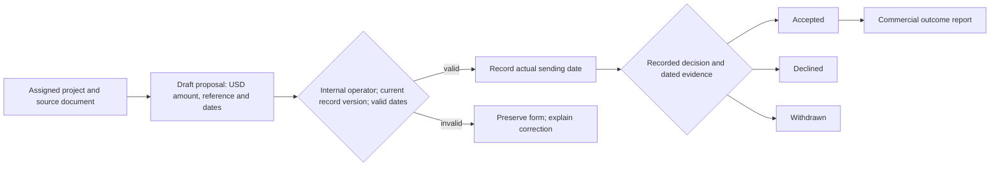
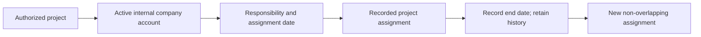
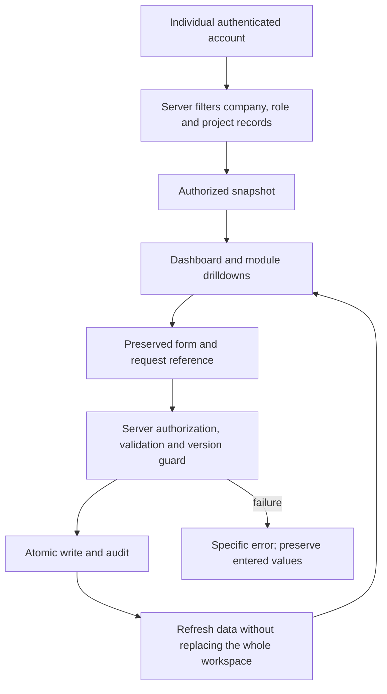

# Business workspace

The executive dashboard is an operational report built from authorized records. It preserves TAYCO's navy, gold and orange material design while separating the company's commercial pipeline, projects, people and dated financial evidence.

## Reading the dashboard

- **Reporting month:** proposals issued by their recorded issue date; acceptances by their decision date; work hours by the work date. A draft is not an issued proposal.
- **Current project status:** saved planning, active, blocked, handover or closed states. Unknown progress stays unknown. These are current records, not reconstructed historical month-end states.
- **Current proposal pipeline:** drafts, sent proposals and recorded decisions. Pending totals span the current authorized portfolio; changing the reporting month does not relabel them as historical balances.
- **Project teams:** explicit assignments to active company accounts, their responsibilities and assignment dates. Work-log submitters are shown separately as evidence of recorded hours, not inferred employees or crew headcount.
- **Monthly financial overview:** dated invoice and payment records, separated by client, supplier and internal audiences. Status and direction cards drill into the corresponding source ledger. Approved budgets, estimates, proposals, invoices and payments retain separate meanings.

Zero recorded invoices does not establish that a company has no revenue or costs. Historical financial statements require complete, reconciled accounting records; this workspace does not substitute estimated bid values for those records.

## Proposal lifecycle

Recording a proposal as sent does not send an email. Recording acceptance does not create a contract, change a project budget, generate an invoice or record cash. Accepted and other decided proposals cannot be silently reopened by the same commands; a changed commercial offer requires a distinct reference and traceable new record.

The backend enforces unique company proposal references, USD cents, valid issue/validity/sending/decision dates, optimistic version checks and idempotent requests. Historical sending and decisions can be entered using their actual dates; dates are never replaced with the current month merely to populate a chart.

## Assignment lifecycle

Project assignments do not grant account permissions. Account provisioning and access assignments remain separate administrator operations. Duplicate active assignments, cross-company accounts, providers masquerading as internal staff, future dates and overlapping assignment history are rejected.

## Access and refresh

Client proposals and internal team rosters are currently internal modules. Clients and providers retain their existing assigned project views; internal roster fields and proposal records are excluded from their server payloads. No customer invitation, email delivery or live external integration is enabled by these modules.

## Visual stability

Two SVG accessibility titles previously used multiple JSX children. Browser parsing and React hydration disagreed about their text structure, causing the console subtree to be rebuilt. Titles now render as one computed text child. Regression checks retain all runtime hydration errors instead of hiding them.

Operational cards also keep fixed hit targets: the global editorial animation engine skips panel tilts, click scaling and unmanaged decorative node insertion inside the workspace. CSS hover and keyboard focus feedback remain available. Public editorial surfaces retain their existing animation behavior.
