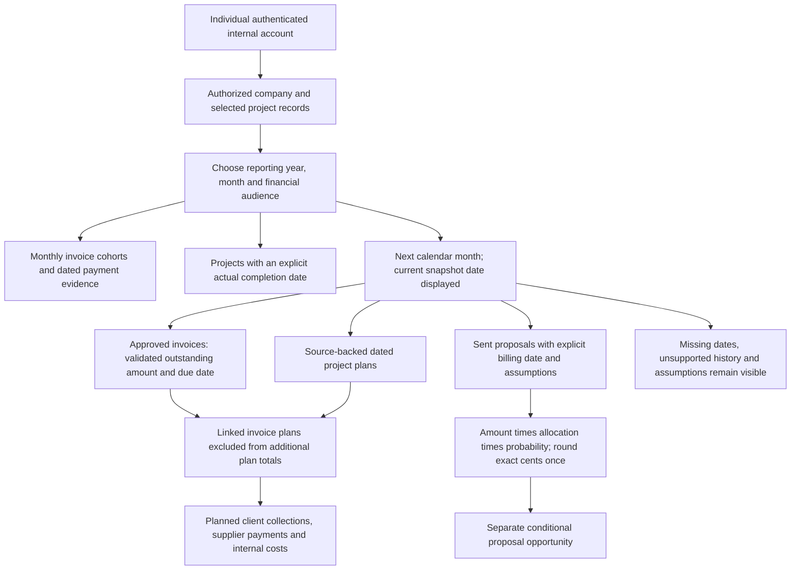
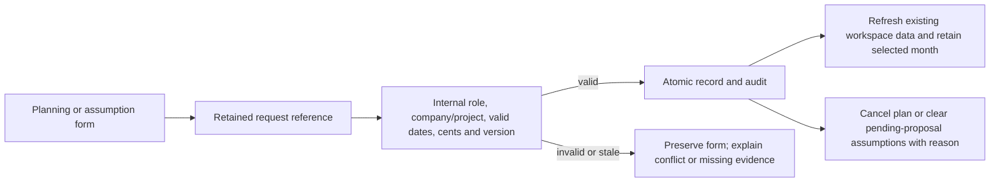
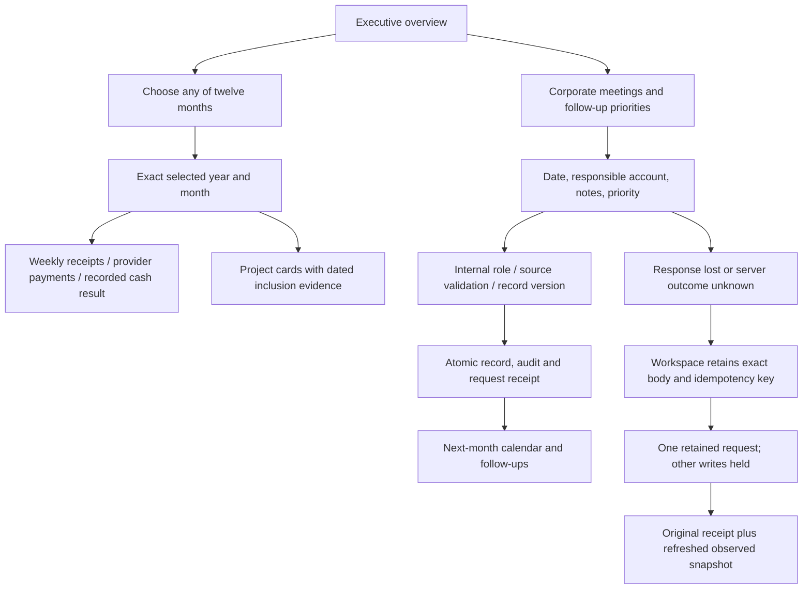

# Financial dashboard and next-period planning

The internal Finance dashboard is a direct workspace destination. It provides twelve-month invoice/payment evidence, selected-month sources, dated project completion and the next-period planning scenario. It does not replace the external client's narrower Financial overview.

## Meaning and boundaries

1. The monthly chart uses the existing canonical invoice/payment model. Client, supplier and internal directions remain separate. An invoice's current approval status is not a bank transaction.
2. A project's completion month requires a recorded completion date and evidence. Closing its status or setting progress to 100% does not invent a date, invoice or collection.
3. Approved invoice balances due next month can inform planning only when their amount and payment history are valid. Paid flags without usable history, undated sources and malformed histories require review.
4. A project plan has an explicit direction, amount, due date and source. Plans linked to an invoice are not added a second time. Unlinked plans can describe distinct planned work; their source and potential overlap remain an operator responsibility.
5. Proposal opportunity requires explicit expected billing date, allocation percentage, probability percentage and assumption source. Drafts, declined/withdrawn/accepted decisions and unconfigured assumptions do not silently become forecast cash. No automatic probability is inferred from a sales stage.
6. The next-month view uses the current authorized snapshot. Selecting a past reporting month does not reconstruct an old forecast or an old month-end balance.

## Durable edits

No planning edit initiates a payment, sends a proposal, contacts a provider, modifies the estimate archive or posts an accounting transaction. Completion evidence, plan sources and assumption history remain internal; externally assigned users receive only their existing authorized project fields.

## Review of the design

The useful flow is month → direction → source → next-period assumption → correction. The primary failure modes are double counting, missing payment timing, inferred completion, uncertain proposals masquerading as committed receipts, and external users receiving internal cost assumptions. Validation rejects invalid inputs; the report excludes ambiguous sources with visible coverage notes; source drilldowns and versioned edits provide recovery. Model tests and authenticated GUI checks must verify these behaviors before this capability is marked complete.

## Client dashboard hierarchy and interactive months

The executive dashboard follows the client reference: current TAYCO logo, four source-backed indicators, a twelve-month chart, dated agenda, quick access, follow-ups and a next-month calendar. Invoice issuance is labelled as invoice records rather than assumed bank revenue. Each month opens the financial dashboard with that exact year and month.

The monthly detail groups dated client payment receipts and provider payment entries into Monday–Sunday weeks clipped to month boundaries. Their difference is a recorded cash movement result, not accrual profit: unknown payroll, overhead, taxes and unclassified internal entries are not silently treated as zero costs. Issued invoices remain separate from cash movement. Voided, duplicate and future payment sources follow the canonical reporting validation.

Projects belong to the month only through recorded schedule overlap, dated milestones, work logs, invoice issuance/payment, proposal activity or evidenced completion. Current active status and creation timestamp do not reconstruct historical project activity. Each card states its inclusion evidence and opens the project.

## Corporate meetings and next-month follow-ups

Corporate meetings and follow-ups are company-wide internal operational records. Their modules explicitly display company scope and do not offer a project filter that would leave the list unchanged. Their dates, optional local meeting time, location, responsible internal account, notes and priority are stored with version checks and idempotent request references. Meeting states (scheduled/completed/cancelled) and task states (open/in progress/completed/cancelled) are explicit; state changes retain a reason. These records do not send invitations, reminders or calendar notifications.

Pending request recovery survives changing modules or project selection inside the mounted authenticated workspace. It intentionally does not place private mutation payloads in browser storage; closing/reloading the workspace is a separate recovery limitation, not a durable offline queue.
