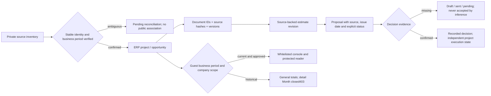

# Guest review: source reconciliation before import

The command center presents read-only current-month records, and historical general totals. Making a navigation option visible does not manufacture the underlying business event or certify a private document delivery.

## One source graph

## Reconciliation manifest

The private operator inventory must identify:

- A stable source opportunity ID and the intended ERP project ID, or an explicit create decision.
- Source context/project keys and a confirmed business reporting period.
- Document IDs, SHA256, byte size, version and their exact project relationship.
- Each estimate revision and its source date, revision identifier, currency and meaning.
- Each proposal and its source, issue date, state and any independent decision evidence.
- Publication eligibility and unresolved identity/source/date/conflicting-version flags.

No fuzzy name association is promoted automatically. The Atlas7 drawing-derived bundle and ARTEMIS opportunity inventory are independent sources; matching counts do not prove that they describe the same opportunities.

## Semantic boundaries

An invitation to bid is not a TAYCO proposal. An estimate is not an accepted proposal. An accepted proposal is not a finished project. An invoice is not a dated payment. A project-wide budget is not the TAYCO scope value or company revenue. Unknown values stay null/pending with their missing source; guessed amounts must not fill an actual ledger.

Company-reported commercial stages preserve attribution and unknown event dates. They do not create a fictitious meeting, submitted proposal, signature, insurance approval or financial entry.

The dry-run must report creates, updates, semantic no-ops, conflicting IDs/hashes, missing sources and unidentified records before a transactional, idempotent commit. Private source rows, documents, databases and credentials stay outside Git and public assets. Runtime private-reader, expiry/revocation and actual upload verification remain separate gates.
