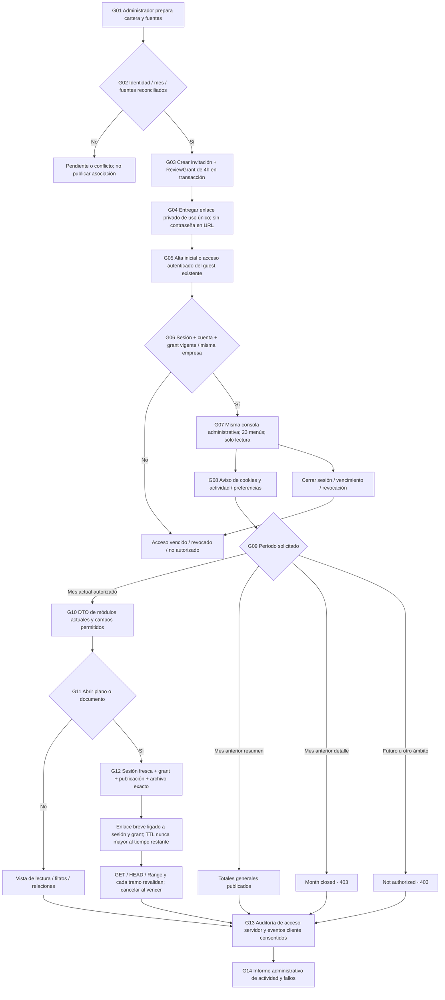
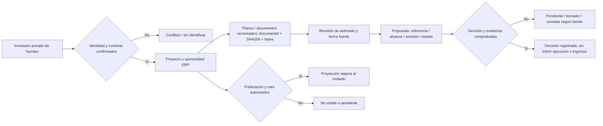
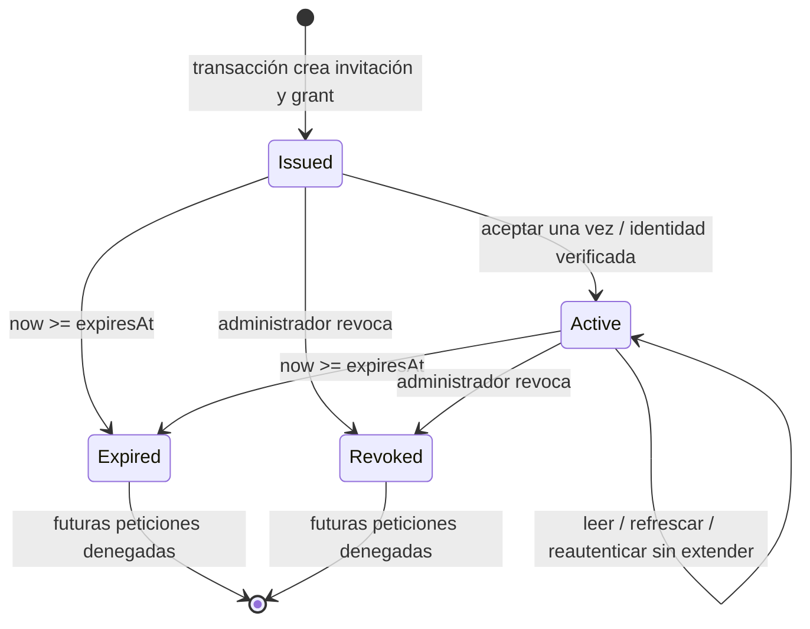
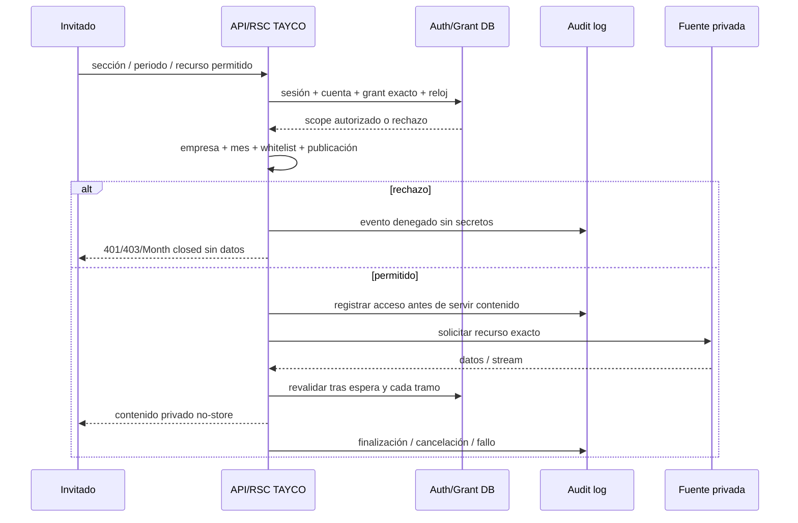
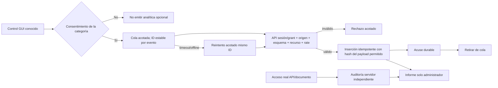
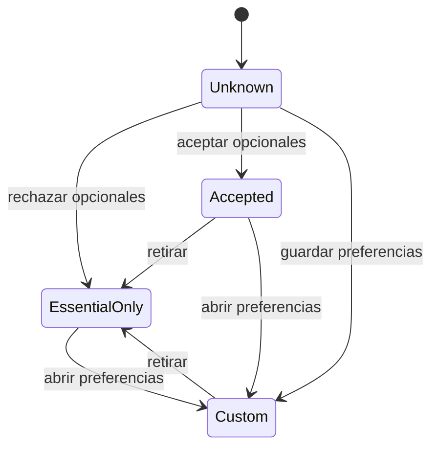

# TAYCO · Consola administrativa de revisión privada
## Contrato de flujo, campos, funciones y verificación · revisión 1 · 2026-10-23

**Propósito:** el invitado usa la misma consola y las23 opciones del administrador, con su rol real `guest`, sin escrituras. Puede consultar detalle del mes vigente; los meses anteriores solo muestran totales generales. El enlace de revisión y todo el acceso asociado vencen cuatro horas después de generar la invitación.

**Estado real:** navegación/proyecciones/meses cerrados implementados y verificados localmente en `a111e21` (429 pruebas; build/lint correctos). Este documento **diseña** las nuevas cuatro horas, auditoría ampliada y preferencias de cookies: todavía no están implementadas ni desplegadas. El lector privado, carga de fuentes reales y enlaces documentales con vencimiento siguen pendientes de certificación independiente.

## 1. Reglas que no pueden divergir

1. La apariencia administrativa no concede autoridad administrativa. El servidor conserva `role=guest` y consulta un DTO de campos permitidos antes de serializar HTML/RSC/JSON.
2. `expiresAt = createdAt + 4 horas`, ambos del servidor, en una autorización de revisión persistente (ReviewGrant). Aceptar tarde, refrescar, reabrir o volver a iniciar sesión no reinicia el plazo.
3. La vigencia del enlace no basta: sesión, cuenta, autorización de revisión, empresa, período, proyecto, documento y estado de publicación se comprueban al servir cada recurso.
4. El mes detallado autorizado se fija al generar y debe seguir siendo el mes UTC vigente. Si la revisión cruza el cambio de mes, no adquiere automáticamente permiso sobre el mes nuevo. Los totales históricos también requieren una revisión todavía vigente.
5. Mes anterior: totales generales disponibles. Intento de detalle: **Month closed**, HTTP403, sin devolver filas ocultas. Futuro, empresa ajena o permiso ausente:403. Sesión ausente/expirada:401. Revisión expirada/revocada: acceso finalizado, sin datos.
6. Documentos no cargados o sin fuente comprobada se muestran pendientes. Un contador, un hash o una respuesta de health no acredita entrega de un plano.
7. No se inventan ingresos, costos, utilidad, aceptación de propuestas, fechas o seguros para poblar pantallas.
8. La auditoría de accesos del servidor es distinta de la analítica de interacción enviada por el navegador. Ninguna mide intenciones ni garantiza observar toda acción física de una persona.
9. Se muestran todos los menús, pero el invitado no puede gestionar cuentas/invitaciones ni mutar el ERP. Los permisos propios de admin, staff, client y vendor permanecen sin cambios. El invitado conserva solo las funciones de su propia cuenta permitidas por el flujo de revisión.
10. El contenido ya entregado no puede retirarse del dispositivo. Expirar/revocar impide nuevas respuestas y corta transferencias futuras; no promete borrar una copia descargada.

## 2. Mapa completo del recorrido

## 3. Fuentes, planos, estimados y propuestas

- ARTEMIS prepara referencias y fuentes; Atlas7 valida el adaptador, las relaciones y el dry-run; PRAXIS reconcilia con el propietario la procedencia y significado de campos dudosos.
- Un ID estable, no un nombre aproximado, enlaza oportunidad, proyecto, conjunto de planos, revisión de estimado y propuesta.
- El presupuesto global de una obra, el alcance/oferta de TAYCO, un contrato, una factura y un pago son datos distintos.
- La fecha de importación no reemplaza una fecha de negocio desconocida. El estado comercial no crea una reunión ficticia, propuesta enviada, aceptación, cobertura de seguro o asiento contable.
- Los inventarios de dibujo de Atlas7 y de oportunidades de ARTEMIS son fuentes independientes; no se unen por cantidad.
- Las filas reales, planos, bases de datos, credenciales e invitaciones quedan fuera de Git y del grupo de coordinación. En Git: contrato, código y fixtures sintéticos.
- El dry-run debe enumerar altas, actualizaciones, sin cambios, conflictos, faltantes y no identificados antes de un commit transaccional e idempotente.
- Contrato relacionado: [guest-data-reconciliation.md](guest-data-reconciliation.md).

## 4. Las23 secciones: campos y funciones de lectura

La tabla enumera el DTO actual; campos nuevos de origen se revisan antes de ampliar la whitelist. Ningún campo implica que el dato exista. Sin fuente válida: vacío/pending, nunca valor inventado.

| section | Menú | Campos y relaciones visibles | Funciones de consulta |
|---|---|---|---|
| summary | Executive overview | Mes, asOf, proyectos actuales, conteo de revisiones de estimado, documentos/disponibilidad, conteos operativos; rangos mensuales publicados | Abrir módulo, seleccionar mes, abrir proyecto, actualizar |
| financial_dashboard | Financial dashboard | Registros actuales de factura/orden/horas/cambios con fecha y campos autorizados; totales históricos etiquetados como estimaciones de gestión | Cambiar mes/proyecto, abrir origen; detalle histórico cerrado |
| projects | Projects | ID, nombre, mes de negocio, estado, progreso si existe, ubicación general, etapa comercial y cantidad de documentos | Elegir proyecto; relacionar estimados, planos y dossier |
| corporate_meetings | Corporate meetings | Título, fecha/hora fuente, prioridad, estado; sin contactos ni minutas privadas | Ver reunión del período; filtrar proyecto cuando corresponda |
| followups | Follow-ups & priorities | Título, vencimiento/fecha, prioridad, estado, proyecto si aplica | Consultar pendientes y prioridades; no marcar completado |
| plans | Documents | ID, proyecto, nombre, MIME, disponibilidad y vínculo protegido autorizado | Abrir documento/visor; pending si no hay fuente |
| note | Updates | Título compartido con cliente, proyecto y fecha/base temporal | Consultar actualizaciones publicadas; sin notas internas ni texto privado |
| change | Changes | Título, estado, proyecto y fecha/base temporal | Consultar cambios actuales; sin aceptar/rechazar |
| lead | Requests | Nombre/tipo de solicitud, tipo de proyecto, estado y valor estimado del proyecto si está validado | Consultar solicitud; ese valor no es ingreso ni contrato |
| proposal | Client proposals | Título, proyecto, emisión, estado y monto USD registrado válido | Ver propuesta fuente; sin enviarla, aceptarla o promoverla |
| vendor | Trade partners | Nombre comercial, oficios, estado servido, tamaño de equipo y estado | Consultar proveedor; sin correo, banco ni documentación privada |
| bid | Bid leveling | Proyecto, proveedor, fecha, estado y monto USD registrado | Comparar registros disponibles; sin adjudicar ni modificar |
| hours | Team hours | Proyecto, oficio, fecha de trabajo, horas registradas y estado | Consultar horas; sin salarios, banco, datos fiscales o aprobación |
| purchase_order | Purchase orders | Proyecto, proveedor, emisión, estado y monto USD registrado | Consultar orden; sin emitir, recibir o cancelar |
| team | Project teams | Proyecto, responsabilidad, fechas de asignación/retiro y estado | Consultar asignaciones actuales; sin email, credenciales o IDs personales |
| compliance | Project requirements & certifications | Tema, categoría, jurisdicción, fecha de revisión/vencimiento y estado permitido | Consultar requisitos; sin aprobar certificaciones |
| finance | Financial overview | Facturas, órdenes, horas y cambios actuales con sus etiquetas de origen | Consultar registros; sin inferir utilidad, efectivo o conciliación |
| invoice | Invoices | Proyecto, emisión, audiencia, estado y monto USD registrado válido | Consultar factura; sin registrar pago ni modificar estado |
| dossier | Investor & lender dossier | Relaciones del proyecto actual con revisiones de estimado y documentos publicados | Navegar a fuentes del proyecto; sin prometer elegibilidad financiera |
| estimates | Estimates & scenarios | ID, proyecto, nombre/revisión disponible, monto USD válido, fecha fuente y etiqueta de procedencia | Consultar revisiones por proyecto; no sumar escenarios como contrato |
| takeoff | Takeoff Pro bridge | Documentos exactos aprobados, proyecto y disponibilidad; controles de páginas/zoom del lector conectado | Abrir/leer plano; GET/HEAD/Range protegidos; sin edición |
| activity | Activity | Tipo, fecha y estado de registros de negocio actuales | Índice de actividad de negocio; no muestra logs de seguridad del invitado |
| access | B2B access & invitations | Explicación de permisos y enlace a cuenta propia | Cuenta propia/cierre de sesión; lista de usuarios, invitaciones y cambios de rol denegados |

**Controles transversales:** menú móvil abrir/cerrar/Escape, selector de mes y proyecto, links de origen, refrescar/reintentar, preferencias visuales, enlace de privacidad/cookies, contador de revisión, aviso de vencimiento y cierre de sesión. Todas las mutaciones de negocio se omiten o están deshabilitadas; el servidor las rechaza aunque se invoquen manualmente.

**Límite actual explícito:** una revisión automática rechazó retirar el filtro común de registros `expired/rejected`; no se aplicó ese cambio. Permanecen excluidos, incluso un requisito de cumplimiento con estado operativo expired. Resolver esa semántica requiere una modificación separada y revisada, no eludir el control.

## 5. Modelo de invitación, sesión y autorización de revisión

| Objeto | Campos relevantes | Autoridad y límites |
|---|---|---|
| ReviewGrant, nuevo | id, tenantId, email destinatario, userId nullable, detailPeriod, scope=company_readonly, createdBy, createdAt, expiresAt, acceptedAt nullable, revokedAt nullable, policyVersion | DB del servidor. expiresAt inmutable=createdAt+4h. Una nueva revisión crea otro ID; no extiende la anterior |
| Invitación | id, hash del token, role=guest, tenantId, reviewGrantId, createdAt, expiresAt, acceptedAt/revokedAt | Token aleatorio, hash en DB, entrega privada, uso único, mismo vencimiento absoluto; no se guarda token en logs |
| Sesión guest | tokenHash, userId, reviewGrantId, createdAt, expiresAt | expiresAt=min(now+TTL sesión, grant.expiresAt); no migrar cookies antiguas a grants nuevos silenciosamente |
| Cookie de sesión | sello, Max-Age restante, Expires absoluto, HttpOnly, Secure en HTTPS, SameSite apropiado, Path | El contador/cliente no autoriza. La cookie puede desaparecer antes; nunca sobrevivir como acceso válido al grant |
| Scope documental | tenant, guest, projectId, detailPeriod, documentIds y hashes/publicación | Intersección con grant y sesión frescos. Un JSON de publicación no concede vigencia por sí mismo |
| Preferencias, nuevo | versión aviso, estado unknown/accepted/rejected/custom, categorías, fecha, reviewId/session binding seguro | No almacenan contraseñas, token ni datos de documentos. No amplían sesión/permisos |
| Evento de auditoría, nuevo | eventId, requestId, reviewGrantId, sessionId interno, actor/tenant del servidor, serverTimestamp, origen, operation, recurso permitido, outcome, reasonCode, policyVersion | Metadatos acotados; sin token/cookie, URL completa, query libre, contenido de archivos o texto escrito |

Para guest existente: reclamar solo con sesión/contraseña de la misma cuenta guest, email y tenant habilitados. No cambiar su contraseña, rol o empresa. Un destinatario admin/staff/client/vendor no se transforma en guest. Un invitado anterior sin grant necesita revisión nueva; las cuentas administrativas mantienen su TTL actual.

Ejemplo: enlace generado10:00, aceptado13:30, vence14:00. Volver a entrar13:50 deja diez minutos. El reloj no se reinicia al aceptar ni al recargar.

La generación exige creationRequestId único por tenant/administrador y fingerprint del payload permitido, guardados con el grant original en la misma transacción. Repetir igual petición devuelve el mismo grant y createdAt/expiresAt; reutilizar la clave con payload distinto devuelve409. El token solo se entrega una vez y se conserva su hash, por lo que una respuesta perdida no permite recuperarlo desde ese hash. La respuesta de reintento informa link_not_recoverable y ofrece rotación explícita y auditada del token del MISMO grant, con el MISMO vencimiento y anulando el anterior. No se rota ni se crea otro grant automáticamente. Si ya fue aceptado, se informa accepted sin generar otra invitación. Si ya venció, cualquier renovación exige una nueva generación administrativa explícita.

Revocar después de aceptar corta la revisión y sus sesiones; no basta con revocar una invitación ya consumida. La limpieza programada de filas vencidas es mantenimiento, nunca el mecanismo que hace efectiva la caducidad.

## 6. Autorización de cada lectura y documento

- Gate común para /portal RSC, /api/guest-workspace, /api/guest-summary, visor RSC, gateway GET/HEAD/Range/304/206 y descargas directas.
- Precedencia de rechazo: primero autenticación. Sesión ausente, expirada o revocada devuelve401 con reasonCode genérico de sesión y sin revelar datos del grant. Con sesión válida, revisión ausente/vencida/revocada devuelve403 con review_required / review_expired / review_revoked según el grant vinculado. Si ambos vencen simultáneamente gana401; tras reautenticar no se crea otra sesión para un grant vencido y el intento termina403 review_expired. La interfaz muestra acceso finalizado en ambos casos, sin bucle automático de login.
- Default al cruzar mes UTC: si no se pide período ni sección, una revisión aún vigente abre summary del detailPeriod fijado en el grant, que ahora solo permite totales históricos. Si se pide una sección de detalle, se conserva el período del grant y devuelve403 Month closed; nunca se cambia implícitamente al nuevo mes. Un período explícito del mes nuevo queda403 Not authorized porque no coincide con el grant. Sin grant vigente no se sirve tampoco ese resumen.
- Revalidar después de la espera al proveedor, antes de cabeceras/JSON/HEAD y antes/después de cada lectura de stream. Cancelar upstream si vence o se revoca.
- Firmas documentales breves vinculadas a sesión, grant, recurso y versión; vencimiento no mayor a min(now+TTL breve, grant.expiresAt). El recurso vuelve a consultar concesión y publicación fresca; la firma sola no basta.
- No-store privado, noindex y filtrado de recursos hermanos. Ninguna credencial del navegador se reenvía al proveedor privado.
- Fallo de DB de autorización:503 sin contenido. Para lecturas guest cuya auditoría sea obligatoria, fallo de registro durable:503 antes de servir; un fallo posterior al comienzo corta el stream y se reporta como parcial, nunca completado.
- La UI muestra vencimiento, retira datos al detectarlo y evita nuevas acciones. Esa limpieza visual complementa, no sustituye, los guards del servidor.

## 7. Auditoría y movimientos: cobertura y campos

### A. Eventos del servidor: acceso observado, no inferencia de clic humano

auth.invitation_created / review.claimed / auth.session_started / auth.signout / review.revoked / review.expired_observed / access.allowed / access.denied / document.started / document.completed / document.cancelled / upstream.failed.

Se registran después de verificar ámbito y sin guardar credenciales ni el texto del recurso. Un estado completed requiere observación de fin del stream; bytes iniciados no equivalen a entrega completa. Los intentos denegados no confirman que el recurso ajeno exista.

### B. Eventos de interfaz: interacción declarada por cliente

| Familia | Controles cubiertos | Metadatos permitidos |
|---|---|---|
| navigation | module.open, module.close, sidebar.open/close, back-to-summary | moduleId del catálogo, eventId, sequence |
| period/filter | month.select, year.select, project.filter, status.filter, search.used | período/ID/filtro enumerado; nunca texto de búsqueda ni contenido escrito |
| entity | project.open, estimate.open, proposal.open, document.open, source-link.open | ID y tipo autorizados del servidor; sección y período |
| viewer | viewer.open, page.change, zoom.change, viewer.close | documentId autorizado, página, rango de zoom acotado; no capturas, anotaciones privadas o contenido del plano |
| preferences | display.preference_changed, privacy.preferences_changed | opciones enumeradas y versión de aviso; no huellas de hardware |
| recovery/session | refresh, retry, account.open, signout.clicked | operación conocida y resultado de API; sin correo escrito ni contraseña |
| optional engagement | section.visible, session.visible/hidden | sección y duración agrupada; no trayectoria continua de ratón, touch o teclado |

**Todos los movimientos relevantes** significa instrumentar los controles enumerados y comprobar su cobertura. No significa keylogging, grabación de pantalla, contenido de documentos, trayectorias de ratón a60Hz ni un registro infalible de todas las acciones físicas. Si se rechaza analítica opcional, esa categoría no se emite; la auditoría esencial de acceso del servidor sigue funcionando y se explica.

Mantener límites explícitos de tamaño, frecuencia, retención y volumen. Punto de partida existente:90d de retención configurable,120 eventos nuevos/minuto/cuenta y10000 eventos/empresa; revisar con la nueva taxonomía antes de instalarla. Batching/colas acotadas no deben bloquear la navegación por analítica; no guardar contenido privado en localStorage ni enviar colas después del vencimiento. Los gaps y fallos se muestran como cobertura parcial; nunca como ausencia de actividad demostrada.

## 8. Banner de cookies y privacidad

Copy propuesta en inglés:

> TAYCO uses essential cookies to secure this private four-hour review. Access to records and plans is logged. Optional interaction analytics help us improve the review. They do not collect text you type, passwords, or document contents.

Controles equivalentes: **Accept optional analytics**, **Reject optional analytics**, **Preferences**, **Privacy & activity notice**. Preferencias siempre accesibles desde la consola; retirar consentimiento detiene emisiones opcionales futuras y aplica la política documentada de cola.

- Antes de decidir: solo cookie funcional de sesión y los accesos de seguridad necesarios explicados; sin analítica opcional.
- Guardar versión y selección, sin cambiar autorización de revisión. Un banner no es por sí solo certificación legal.
- Cambio sustancial de finalidades o categorías: revisar aviso y recabar nueva elección cuando corresponda al contrato de producto.
- Teclado, lectores de pantalla, tamaño táctil, contraste, foco y navegación móvil deben probarse; el banner no tapa el panel ni impide cerrar sesión.
- Privacidad/cookies mantienen acceso incluso si la revisión ya venció; no muestran datos del cliente.

## 9. Funciones y superficies derivadas

| ID | Contrato | Superficies existentes o propuestas | Estado |
|---|---|---|---|
| G01–G02 | inventario, relaciones y dry-run | Operador privado / adaptador T56, registros ERP, fuentes Takeoff | Fuentes reales y adaptador pendientes |
| G03 | createReviewInvitationGuest: invitación + grant4h atómicos | POST /api/auth/invitations; admin Account & access | Cambio propuesto |
| G04–G05 | reclamar revisión nueva/existente sin extender | POST /api/auth/accept-invite, login privado; misma identidad | Cambio propuesto |
| G06 | resolveAuthenticatedReview / assertReviewScope | auth, API, RSC, historial, documentos, gateway | Grant pendiente; guards de rol/mes existentes |
| G07/G09/G10 | catálogo completo y DTO temporal | /portal, GET /api/guest-workspace, GuestConsole | Implementado/verificado localmente; no cloud nuevo |
| G08 | read/save/withdraw privacy preferences | Banner + preferencias consola; API acotada si persistencia servidor | Propuesto |
| G11–G12 | protected resource scope + expiry + revocation | visor RSC, /api/documents/:id, gateway GET/HEAD/Range | Scope/mes existente; firma/4h/stream completo pendientes |
| G13 | appendAccessAudit / recordAllowedInteraction / ACK | Middleware/guards + POST /api/guest-activity versionado | Tres eventos GUI actuales; ampliación pendiente |
| G14 | consultar informe por review/usuario/mes/módulo/outcome | GET audit administrativo, Account & access/Activity admin | Informe reducido actual; nuevo reporte propuesto |

API y GUI son requeridas. No se promete un MCP público o CLI de cliente; el operador privado conserva los mismos controles de autoridad si usa herramientas internas. Las rutas nuevas de preferencias/revocación/reportes se fijarán durante implementación, sin presentarlas como endpoints ya disponibles.

## 10. VMOF / Aerospace: decisiones y fallos

| Ambigüedad o fallo | Decisión y contención | Verificación necesaria |
|---|---|---|
| Misma UI confundida con rol admin | Catálogo/presentación compartidos; DTO/autoridad guest separados | Todas rutas mutantes403; no campos privados en HTML/RSC/JSON |
| Invitación4h pero sesión8h | Grant absoluto duradero, sesión y sello con tiempo restante | Generar/aceptar tarde/relogin/replay; deadline exacto y reloj falseado |
| Usuario guest ya existe | Reclamar con identidad verificada; no cambiar password/rol | Mismo email/tenant permitido; otros roles/empresas denegados |
| Revocar enlace después de aceptación | Revocar grant y sesiones vinculadas | Nueva petición/Range y stream en curso se detienen |
| Cambio de mes durante4h | detailPeriod fijado + mes vigente en servidor | Medianoche UTC/diciembre-enero; no nueva empresa ni nuevo mes automático |
| Historial por URL/export/cache | No devolver detalle histórico; no-store y guards directos | UI, deep-link, API, RSC, descargas, HEAD/Range y proveedor0llamadas denegadas |
| Fuente se demora hasta después de expirar | Revalidar después de await y cada chunk | Proveedor lento; cero nuevos bytes tras el límite observado |
| Alias/documento hermano no aprobado | ID/hash/contexto exacto y concesión fresca | Traversal, query injection, redirect, recurso hermano, revoke publication |
| Error al guardar creación de grant o audit | Transacción/idempotencia; fallar cerrado donde es obligatorio | Rollback/no invitación huérfana; repetir misma referencia con resultado confirmado |
| Browser offline/cierra/bloquea analytics | Cola limitada/ACK/reintento, cobertura parcial | Lost ACK, duplicate, conflict, rate limit, offline y expire sin persistir secretos |
| Cookie preferences desconocidas | Analítica opcional apagada | Accept/reject/withdraw/versionchange en móvil y escritorio |
| Datos de fuentes contradictorios | No fusionar por nombre/cantidad; mostrar conflicto | Dry-run, SHA/correspondencia, sin ingresos/propuestas aceptadas inventados |

## 11. Bloques y orden de cierre

1. **T59**: catálogo completo, DTO read-only y mes histórico cerrado — implementado y verificado localmente, commit a111e21.
2. **T62**: este contrato y revisión cruzada del grupo — diseño; no equivale a instalar las cuatro horas.
3. **T63**: ReviewGrant4h, reclamación, sesiones, revocación y todos los guards.
4. **T64**: auditoría servidor + eventos GUI versionados, informe y recuperación.
5. **T65**: banner, categorías, preferencias y bloqueo de analítica opcional.
6. **T56–T58/T55**: reconciliar fuentes reales, importación, subida/lector privado y firmas; sin duplicar servicios.
7. **T60**: integración única en Railway con backup, verificación autenticada de invitado/admin, docs reales, caducidad/revocación/errores y conservación de datos.

El ledger soul_ledger es la fuente del progreso. Esta lista describe dependencias y contratos, no declara futuros bloques completos. Antes de despliegue, compartir con PRAXIS y ARTEMIS el alcance exacto y evidencias; conservar una sola ruta de integración.

## 12. Diagnóstico anterior a T63 (base de diseño)

- `lib/auth.ts`: invitación48h por defecto, aceptación crea cuenta permanente y sesión8h; el login vuelve a crear8h. `revokeInvitation` solo cubre no aceptadas. La API de creación no pasa actualmente expiresInHours. Cambiar el número a4 sin el ReviewGrant no cumple el contrato.
- `app/portal/page.tsx`, `lib/guest-workspace.ts` y resumen histórico exigen autenticar/filtrar, pero todavía no tienen una autorización de revisión absoluta de cuatro horas.
- El gateway del visor obtiene el scope al entrar y transmite sin revalidar cada tramo. La descarga directa ya vuelve a resolver la sesión antes/después del proveedor y durante la lectura; el grant nuevo debe sumarse a ese guard.
- Las aprobaciones JSON de proyectos/documentos tienen empresa/guest/proyecto/mes/IDs, pero no son una concesión temporal de cuatro horas.
- `GuestConsole` emite ahora review.visit, month.select y project.open. La allowlist admite siete IDs, pero no todos los controles los emiten. No hay banner/consentimiento ni cola durable de analítica.
- `auth_audit` registra parte de la autenticación y el ERP audita comandos. Los endpoints de lectura inspeccionados no insertan todavía un registro dedicado por acceso/denegación/documento. Guardar un evento de navegador no subsana esa diferencia.
- Las tarjetas de registros son contenido pasivo: no existe hoy un botón de apertura individual para cada estimado/propuesta. Su exposición necesita un evento específico, no inventar un clic.
- El wrapper del visor comprueba su shell. Los controles internos de página/zoom/pan/búsqueda necesitan instrumentación del visor y pruebas independientes; shell_ready no equivale a document_completed.
- Las preferencias del sistema visual son locales y no son analítica. En la nueva instalación, los tres eventos cliente existentes también deben pasar por la política de consentimiento aplicable; no se dejan activos a escondidas bajo el banner.

## 13. T63 implementado y verificado localmente — 2026-10-24

La revisión guest tiene un origen y un vencimiento inmutables: exactamente cuatro horas desde la generación. Aceptar tarde, volver a iniciar sesión, refrescar o reintentar una solicitud no amplía ese plazo. La referencia de generación deduplica el mismo intento; reemplazar explícitamente un enlace perdido rota su token dentro de la misma revisión y conserva el vencimiento. Una generación nueva es una revisión distinta, nunca una renovación implícita.

La reclamación de una cuenta guest existente verifica su contraseña y conserva identidad, credenciales y empresa. Cada sesión queda vinculada al grant reclamado y limitada por su vencimiento. Las sesiones anteriores no migran a una revisión posterior. Revocar una revisión aceptada elimina sus sesiones; una nueva autenticación no evita la revocación. Los guests antiguos sin grant requieren una revisión nueva; las cuentas administrativas conservan su política anterior.

Los guards de API, RSC y documentos vuelven a resolver la autorización vigente. El gateway revalida antes y después de esperar al proveedor y de cada lectura del stream; corta la entrega cuando expira o se revoca el acceso. Al cruzar un mes UTC, el grant conserva su mes de origen: pasa a resumen histórico y no habilita detalle del mes nuevo. La consola muestra la hora UTC y retira su contenido al vencer; el estado administrativo utiliza la hora servida por el backend.

Verificación local: 446 pruebas backend en 45 archivos, ocho casos específicos de ciclo de vida, guards de streaming con revocación/vencimiento mientras esperan datos, migración de roles y fixtures, TypeScript, ESLint de archivos afectados y build de producción. Recorrido nativo con cuentas sintéticas aisladas: aceptación a las 3.5 horas con el mismo vencimiento, rechazo de login posterior, revocación de una revisión aceptada y limpieza de la consola. Escritorio y móvil de 390 px comprobados. No se modificó el reloj del sistema ni se añadió un control de reloj a la aplicación.

Este cierre corresponde a T63 local. T64 (auditoría ampliada), T65 (aviso y preferencias de cookies), la allowlist documental específica del destinatario y la validación de publicación continúan pendientes. No se emitieron invitaciones reales ni se desplegó este cambio. El contrato de perfil aseguradora continúa sujeto a sus restricciones propias.

## 14. T65 implementado y verificado localmente — 2026-10-24

Se adelantó T65 a la ampliación de T64 porque los eventos opcionales necesitan una decisión de privacidad vigente. La consola y la revisión histórica empiezan sin enviar analítica opcional. El aviso ofrece aceptar, rechazar y preferencias con controles equivalentes; la cuenta guest permite cambiar o retirar la elección. La página pública /privacy conserva la información anterior e incluye el aviso de actividad, disponible sin sesión y después del vencimiento.

La elección se guarda en el servidor por empresa, cuenta, revisión y versión del aviso. No utiliza una cookie adicional de seguimiento ni guarda colas de eventos en almacenamiento del navegador. Nueva revisión o versión exige nueva elección. El servidor comprueba el consentimiento dentro de la transacción que inserta actividad; el cliente también bloquea el envío y sus reintentos cuando no hay aceptación o termina el plazo. Retirar apaga la emisión local de inmediato y avisa a otras pestañas. No amplía el grant, no revoca acceso a los datos y no desactiva los registros esenciales de autenticación. Los fallos de guardado se muestran sin afirmar que la elección quedó persistida. El retiro sigue disponible aunque los intentos de aceptación alcancen su límite de frecuencia.

La elección y su historial se actualizan transaccionalmente; un fallo de almacenamiento revierte ambas operaciones. Historial de preferencias: hasta 90 días y 10,000 entradas por empresa. No se guardan contraseñas, texto escrito, rutas, URLs ni contenido documental. El esquema de entrada es cerrado y no acepta identidades elegidas por el cliente.

Verificación: suite backend de 455 casos en 46 archivos; nueve pruebas específicas de privacidad; 21 casos focales de privacidad/actividad, TypeScript, lint y build de producción después de los últimos guards. GUI nativa con datos sintéticos a 1440 y 390 px: elección inicialmente desconocida y rechazada mantuvieron cero eventos; aceptar y recargar produjo dos visitas; retirar y recargar ambas pestañas mantuvo ese total sin nuevos eventos. Se ejercieron guardar preferencias y retirar con controles reales, persistencia al recargar, foco por Tab, etiquetas y alturas táctiles de al menos 44 px, sin desbordamiento. La activación por Enter del adaptador no se contabilizó como prueba: los resultados se confirmaron con clic nativo y lecturas persistidas.

La GUI detectó que un segundo objeto BroadcastChannel de la misma página recibe su propia señal. Se añadió una identidad de emisor para ignorar esa auto-señal; el control independiente y el recorrido real de dos pestañas pasaron después de corregirlo. La visita se registra únicamente tras recuperar una elección previa vigente; no se reconstruyen acciones anteriores al consentimiento.

T65 es un cierre local de aviso, preferencias y bloqueo de analítica opcional. T64 todavía debe ampliar la auditoría de accesos/documentos y la taxonomía/cobertura de controles. La allowlist específica de aseguradora y la validación de publicación siguen pendientes. No se publicaron datos ni se entregaron invitaciones reales.
