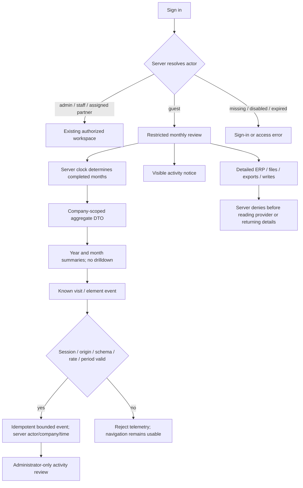
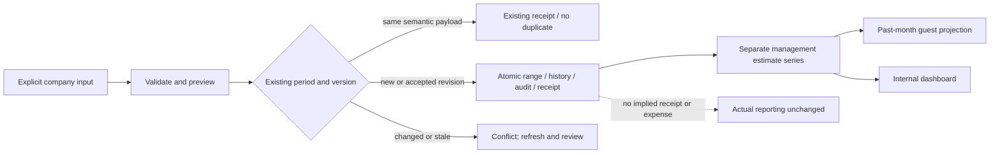
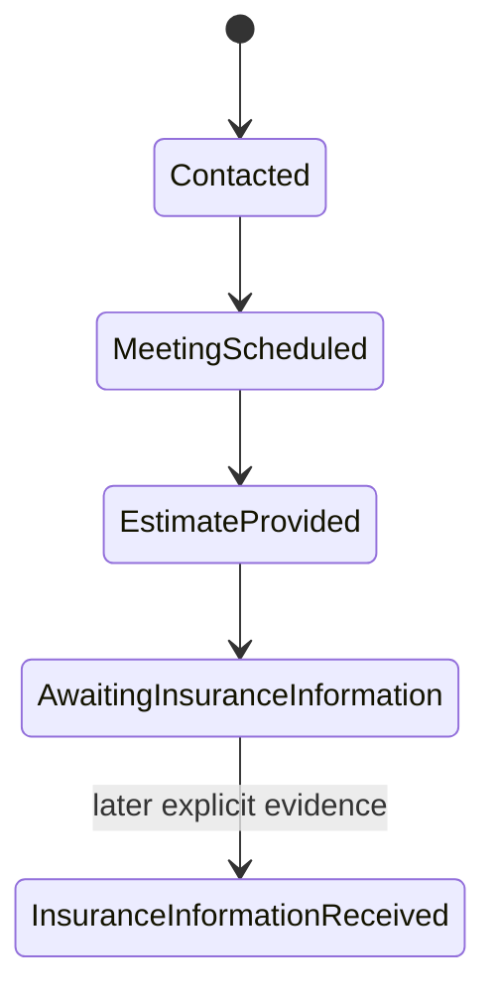

# Private review: guest summaries, management estimates and activity

Design revision 1 · 2026-10-23 · T45–T50.

Purpose: let an invited reviewer understand completed months without obtaining project,
invoice, document, contact or weekly detail. Internal staff keep their existing workspace.
This document describes contracts; runtime certification is recorded separately.

## Confirmed company inputs

- Collect guest visits and selected UI activity; this request does not mean clearing browser caches.
- One generic private review account; no invitation or password is sent by email.
- January–September 2026: approximately USD200,000–500,000 gross **per month**.
  Persist nine management-estimate ranges, not nine fabricated exact receipts.
- October project commercial progress: Contacted → Meeting scheduled → Estimate provided
  → Awaiting insurance information. Do not publish the insurer-error explanation.
- Project identities/plans and Takeoff Pro deployment URL are not supplied yet.
  Prepare the workflow; do not fabricate contacts, meeting dates, proposals or plan files.

## Overall contract

## Authority and data boundaries

| ID | Contract and surfaces | Failure and recovery |
|---|---|---|
| G01 | Add explicit guest role; migrate existing auth schema, preserve users/password hashes/sessions/invites. Guest assignments must be empty. | Transactional migration and foreign-key checks; failed migration does not erase the old database. Back up before cloud upgrade. |
| G02 | Branch guest before portal snapshot/RSC serialization. Dedicated guest component and summary API expose only approved aggregate fields. | No client-side hiding of raw rows. Unauthorized requests return401/403 with no-store. |
| G03 | Previous **months**, plural: server UTC reporting calendar follows existing financial periods. A client clock/asOf cannot authorize current/future periods. | Validate year/month and reject current/future requested periods; rollover tests cover January and year boundaries. |
| G04 | No project IDs/names, invoice rows, contacts, payment references, source notes or document links in the guest DTO. Guest can change own password and sign out. | Test payload/RSC absence and every protected endpoint, including forged nonempty assignments and command replay. |
| A01 | POST bounded semantic events: page visit, month/year selection and explicitly identified controls. Actor, tenant and timestamp come from the session/server. | Reject unknown fields/IDs, spoofed scope, oversized data, cross-origin and rate excess. Stable event IDs deduplicate retries. |
| A02 | GET activity is company-scoped and admin-only; guest cannot query logs. Display the collection notice in the review. | Never collect typed values, passwords, DOM text, invite tokens, arbitrary URLs, fingerprints or screenshots. Client telemetry is best effort, not evidence of all user behavior. |
| M01 | Monthly management estimates have USD range, period, source, author, recordedAt, version/history. Internal versioned writes; guest receives only permitted summaries. | Validate range/cents/period/source; stale writes conflict; repeat imports return the same semantic result. |
| M02 | Estimates remain separate from actual invoice issuance, dated payments and next-month cash plans. | Actual financial reports must not change when estimates are loaded. No assumed expenses or profit. |
| W01 | Commercial-stage history is separate from execution status and proposal decisions. Recorded-at and actual event date are distinct. | Missing dates remain unknown. A meeting stage does not fabricate a calendar meeting; an estimate stage does not fabricate a proposal or acceptance. |
| W02 | Takeoff Pro plan import uses the existing source-backed estimate archive and explicit project identity. | URL/configuration and actual files are pending. No invented endpoint, health claim or automatic financial transaction. |

## Server denial inventory

Guest must be denied detailed GET/POST ERP-suite, finance periods/export, project dossier,
document download/maintenance/upload, hours export, notifications and account/invitation
administration. Domain guards also deny guest in ERP allowed/snapshot/financialSummary/
execute/registerDocument and auth.requireProject. Provider reads/writes occur only after
authorization. Public health and public enquiry submissions retain their existing public contract.

## Estimate and October workflow

When real October project records are supplied, the company-reported completed stages can
be attached with attribution and unknown occurrence dates. They must not imply signed work,
revenue earned, a sent proposal, an actual scheduled meeting or verified insurance.

## VMOF / Aerospace review

- A separate guest role and DTO closes the broad non-vendor fallback found in the current
  portal. Reusing a client with hidden controls would leave API/RSC detail exposure ambiguous.
- A separate estimate store/series preserves useful planning ranges while keeping payment
  and accounting evidence intact. Filling actual invoices for visual density would break meaning.
- A bounded first-party event stream supports product review without harvesting arbitrary
  page data. Loss of telemetry must not block month navigation.
- Detection: migration/FK checks, unauthorized provider-call counters, source/amount/version
  validation, response-field assertions and visible fetch/retry states.
- Containment: company scope, empty guest assignments, fixed event schema, no-store private
  responses, database transaction rollback and no external email send.
- Recovery: retain existing accounts and records; revoke a guest centrally; refresh stale
  estimates; retry an event with its original ID; preserve draft input on errors.
- Evidence required: domain and HTTP adversarial cases, guest/admin GUI at390/1440,
  no detail payload in initial HTML/RSC, and post-deploy authentication/persistence checks.

API and GUI are required. Private operator import/provisioning uses existing supported
authenticated routes/CLI as applicable. No product MCP or public CLI is promised by this request.
Implementation/progress belongs in soul_ledger; this design is not a runtime certificate.

## Implemented operations

- Account & access: administrators invite a guest with no project/vendor assignments;
  guests retain own password/sign-out actions. The server branches before a detailed snapshot.
- Executive overview: compact company management-range series. Open month leads to the
  Financial dashboard, where the internal editor preserves uncertain requests and versions.
  The series is hidden under a project filter because its figures are company-wide.
- The editor stores an explicit range and source; 409 requires reviewing the current version.
  A lost receipt freezes editing until the same payload/reference is retried.
- Account & access → Guest review activity: manual refresh, visits/control counts, most recent
  200 retained events and UTC recording times. Only administrators can read the report.
- Activity accepts six fixed IDs: review.visit, month.select, year.select, account.open,
  summary.retry and session.signout. Month/year are the only optional action metadata.
  No arbitrary click text, input contents, IP/UA or browser identifiers are retained.
  Default retention90days (`TAYCO_GUEST_ACTIVITY_RETENTION_DAYS`,1–365), at most10000
  retained company events and120new events/minute/account. It is best-effort product telemetry,
  not a complete behavioral or security audit. A fixed page token does not record full URLs.
- Projects and commercial requests have a separate internal commercial-progress editor.
  Prior completed steps are explicit checkboxes; unknown occurrence dates stay empty/null.
  The source/history are removed from assigned client/vendor responses.

No January–September exact receipts or October placeholder projects are created by startup.
The nine company-provided ranges are imported explicitly to the isolated review environment.
Takeoff Pro connection and real October files remain dependent on their supplied source/URL.
