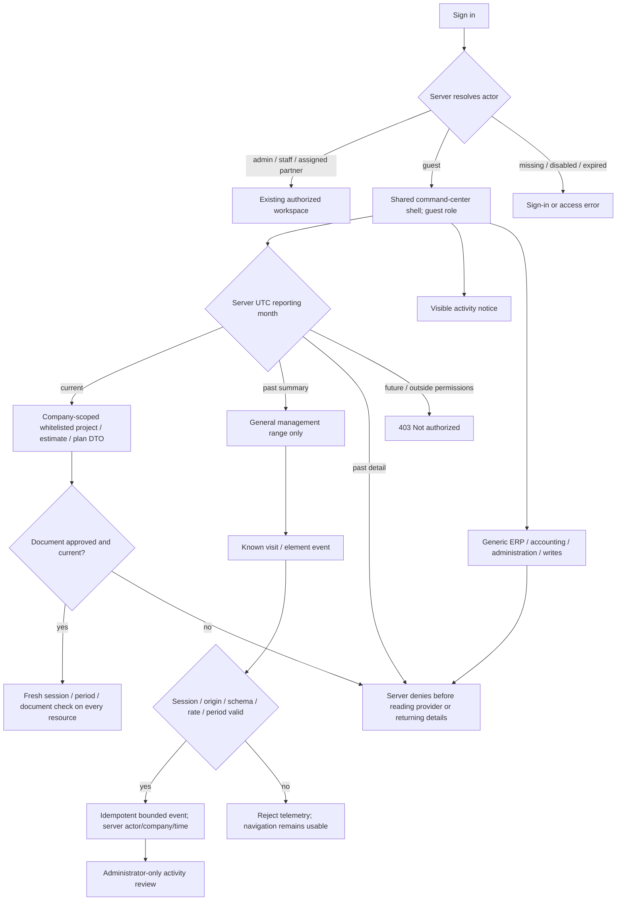
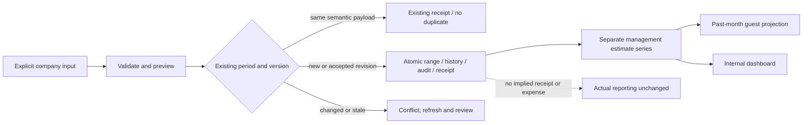
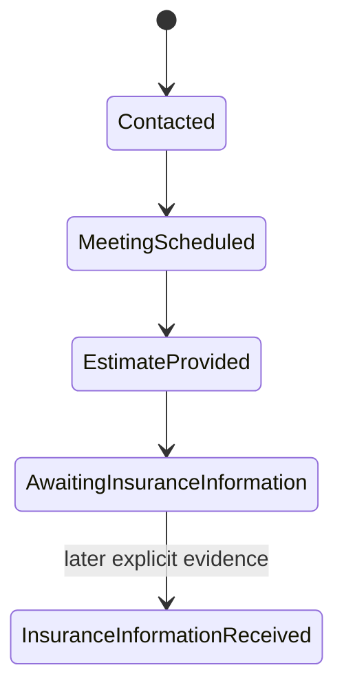

# Private guest command center: current detail and historical totals

Design revision 4 · 2026-10-23 · T45–T50, T59, T61.

This revision supersedes the initial summary-only guest UI. Historical verification below remains evidence of the earlier release, not certification of this revision.

Purpose: let an invited reviewer enter the same TAYCO command-center design with every menu option visible, read whitelisted current-month module records and approved plans, and compare general totals of earlier months. Historical drilldown shows **Month closed** and returns403. The guest remains read-only and never receives administrator authority, raw accounting, contacts or historical detail. Internal staff keep their existing workspace.
This document describes contracts; runtime certification is recorded separately.

## Confirmed company inputs

- Collect guest visits and selected UI activity; this request does not mean clearing browser caches.
- One generic private review account; no invitation or password is sent by email.
- January–September 2026: approximately USD200,000–500,000 gross **per month**.
  Persist nine management-estimate ranges, not nine fabricated exact receipts.
- October project commercial progress: Contacted → Meeting scheduled → Estimate provided
  → Awaiting insurance information. Do not publish the insurer-error explanation.
- Project identities/plans and Takeoff Pro deployment URL are not supplied yet.
  Prepare the workflow; do not fabricate contacts, meeting dates, proposals or plan files.

## Overall contract

## Authority and data boundaries

| ID | Contract and surfaces | Failure and recovery |
|---|---|---|
| G01 | Add explicit guest role; migrate existing auth schema, preserve users/password hashes/sessions/invites. Guest assignments must be empty. | Transactional migration and foreign-key checks; failed migration does not erase the old database. Back up before cloud upgrade. |
| G02 | Branch guest before portal snapshot/RSC serialization. Shared presentational PortalShell with a dedicated GuestConsole and guest-workspace API exposes only approved current detail or historical aggregate fields. No generic management component is mounted. | No client-side hiding of raw rows. Unauthorized requests return401/403 with no-store. |
| G03 | Previous **months**, plural: server UTC reporting calendar follows existing financial periods. Only the server clock authorizes current detail; client period/asOf cannot promote historical or future records. | Validate period and reject historical detail or future requests; rollover tests cover January and year boundaries. |
| G04 | Only approved current project IDs/names, source-dated estimate fields and protected document links enter the guest DTO. No raw invoice rows, contacts, payment references, paths or internal source notes are serialized. Guest can change own password and sign out. | Test payload/RSC absence and every protected endpoint, including forged nonempty assignments and command replay. |
| A01 | POST bounded semantic events: page visit, month/year selection and explicitly identified controls. Actor, tenant and timestamp come from the session/server. | Reject unknown fields/IDs, spoofed scope, oversized data, cross-origin and rate excess. Stable event IDs deduplicate retries. |
| A02 | GET activity is company-scoped and admin-only; guest cannot query logs. Display the collection notice in the review. | Never collect typed values, passwords, DOM text, invite tokens, arbitrary URLs, fingerprints or screenshots. Client telemetry is best effort, not evidence of all user behavior. |
| M01 | Monthly management estimates have USD range, period, source, author, recordedAt, version/history. Internal versioned writes; guest receives only permitted summaries. | Validate range/cents/period/source; stale writes conflict; repeat imports return the same semantic result. |
| M02 | Estimates remain separate from actual invoice issuance, dated payments and next-month cash plans. | Actual financial reports must not change when estimates are loaded. No assumed expenses or profit. |
| W01 | Commercial-stage history is separate from execution status and proposal decisions. Recorded-at and actual event date are distinct. | Missing dates remain unknown. A meeting stage does not fabricate a calendar meeting; an estimate stage does not fabricate a proposal or acceptance. |
| W02 | Takeoff Pro plan import uses the existing source-backed estimate archive and explicit project identity. | URL/configuration and actual files are pending. No invented endpoint, health claim or automatic financial transaction. |

## Server denial inventory

Guest must be denied detailed GET/POST ERP-suite, finance periods/export, project dossier,
document maintenance/upload, hours export, notifications and account/invitation
administration. Domain guards also deny guest in ERP allowed/snapshot/financialSummary/
execute/registerDocument and auth.requireProject. Provider reads/writes occur only after
authorization. Current document downloads use the dedicated guest projection and repeat session/record checks; historical, cross-company, revoked and expired resources fail closed. Public health and public enquiry submissions retain their existing public contract.

## Estimate and October workflow

When real October project records are supplied, the company-reported completed stages can
be attached with attribution and unknown occurrence dates. They must not imply signed work,
revenue earned, a sent proposal, an actual scheduled meeting or verified insurance.

## VMOF / Aerospace review

- A separate guest role and DTO closes the broad non-vendor fallback found in the current
  portal. Reusing a client with hidden controls would leave API/RSC detail exposure ambiguous.
- A separate estimate store/series preserves useful planning ranges while keeping payment
  and accounting evidence intact. Filling actual invoices for visual density would break meaning.
- A bounded first-party event stream supports product review without harvesting arbitrary
  page data. Loss of telemetry must not block month navigation.
- Detection: migration/FK checks, unauthorized provider-call counters, source/amount/version
  validation, response-field assertions and visible fetch/retry states.
- Containment: company scope, empty guest assignments, fixed event schema, no-store private
  responses, database transaction rollback and no external email send.
- Recovery: retain existing accounts and records; revoke a guest centrally; refresh stale
  estimates; retry an event with its original ID; preserve draft input on errors.
- Evidence required: domain and HTTP adversarial cases, guest/admin GUI at390/1440,
  no detail payload in initial HTML/RSC, and post-deploy authentication/persistence checks.

API and GUI are required. Private operator import/provisioning uses existing supported
authenticated routes/CLI as applicable. No product MCP or public CLI is promised by this request.
Implementation/progress belongs in soul_ledger; this design is not a runtime certificate.

## Implemented operations

- Account & access: administrators invite a guest with no project/vendor assignments;
  guests retain own password/sign-out actions. The server branches before a detailed snapshot.
- Executive overview: compact company management-range series. Open month leads to the
  Financial dashboard, where the internal editor preserves uncertain requests and versions.
  The series is hidden under a project filter because its figures are company-wide.
- The editor stores an explicit range and source; 409 requires reviewing the current version.
  A lost receipt freezes editing until the same payload/reference is retried.
- Account & access → Guest review activity: manual refresh, visits/control counts, most recent
  200 retained events and UTC recording times. Only administrators can read the report.
- The legacy summary component accepts six fixed IDs: review.visit, month.select, year.select, account.open,
  summary.retry and session.signout. Month/year are the only optional action metadata.
  The current command-center component emits review.visit, month.select and project.open; the server validates project IDs against the same current projection. No arbitrary click text, input contents, IP/UA or browser identifiers are retained.
  Default retention90days (`TAYCO_GUEST_ACTIVITY_RETENTION_DAYS`,1–365), at most10000
  retained company events and120new events/minute/account. It is best-effort product telemetry,
  not a complete behavioral or security audit. A fixed page token does not record full URLs.
- Projects and commercial requests have a separate internal commercial-progress editor.
  Prior completed steps are explicit checkboxes; unknown occurrence dates stay empty/null.
  The source/history are removed from assigned client/vendor responses.

No January–September exact receipts or October placeholder projects are created by startup.
The nine company-provided ranges are imported explicitly to the isolated review environment.
Takeoff Pro connection and real October files remain dependent on their supplied source/URL.

## Local verification, 2026-10-23

- Auth/domain/HTTP/management/commercial regression:99 passed,0failed
  (`JOB_20261023_160830_2900`). Existing admin credentials/sessions survive the tested
  auth CHECK migration; guest detail boundaries deny before provider reads.
- Production build `mjpcXKagAEpn3uKFU1yMN` and scoped ESLint pass.
- Daedalus instanceatlas7, disposable local fixture at3013: native guest January selection
  changes summary and persists month.select; administrator report observes one visit and
  one control event, while guest report GET returns403. Manual activity refresh works.
- Executive Open month opens the September finance editor with its persisted source/version.
  A native edit plus simulated lost response *after server commit* freezes the form;
  Retry same projection sends identical body/key and confirms without a duplicate update.
- Project commercial editor: native awaiting-insurance selection, three explicit completed
  checkboxes and a source save one report with occurrence date null. Execution staysplanning.
- New guest/activity/range/commercial surfaces checked at390 and1440; no horizontal overflow.
  These checks do not certify every unrelated project module or a physical mobile browser.
- Private evidence `.data/certification/guest-management-20261023/report.json`, SHA256
  `abe39ec3d44fd5ec6b3a1bfce3853fb11c01da3254b7b26453af55a99127d695`.

Cloud release evidence is appended only after deployment and authenticated checks finish.

## Isolated Railway release, 2026-10-23

- Review URL: https://tayco-review-product-review.up.railway.app
- Deployment `d324086c-e176-4c79-9a64-af59988a2f23`: SUCCESS, source
  `8f29374bbdd6044ad339b0186e108ca6b12c7cac`, image digest
  `sha256:0863b6484b17bc5541ae37f8d95b015e145e56a4ee01477eceec2d9b256e7935`.
- Volume backup `d4efc596-5666-46df-bcc8-32b6d0957e25` listed before the auth migration.
  This release did not exercise a cloud restore; the backup identifier is retained for recovery.
- Existing two administrator IDs/access survive. One generic private guest is provisioned
  using an accepted invitation, with empty assignments; no email is sent. Credentials are
  handed over privately outside version control, never in source, queries or public docs.
- Explicit January–September2026 import:9 management ranges ofUSD200000–500000 each,
  with company attribution. Replayed imports use stable request keys; actual ERP entries remain0.
- Authenticated guest HTTP checks: detailed ERP, finance/export, activity reports,
  account administration and estimate sources return403; current/future requested months422.
  The raw portal HTML/RSC contains neither source attribution nor detailed workspace data.
- Daedalus native January and September selections on the deployed site change the selected
  month and are observed in the administrator activity report. Guest390 and1440 have9months,
  collection notice and no horizontal overflow. Activity report is visible to the existingadmin.
- Private release evidence `.data/railway-review/guest-release-verification.json`, SHA256
  `cfff9f6f2f104c71a53473945d371de1402513bc9f9016be25d682e745bbbf6c`.
- Temporary exported cookie files were removed after verification; private handover files remain.

Actual October project names/plans and the protected Takeoff Pro viewer connection are still
pending their supplied records and integration. No insurance incident narrative, false project,
proposal acceptance, invoice, payment, expense or profit was inserted to fill the review.

## Explicit project-plan exception (October23)

Historical financial summaries retain their existing boundary. The later T59 instruction expands the current-month guest console to projects, estimates and plans, while keeping historical detail and all administration denied. Randolf additionally approved sharing selected October projects and plans through the private guest account. This uses separate v2 company/guest/project/document grants, never a general ERP assignment or public document URL. The current protected-reader flow, safe project-summary fields, activity projection and remaining runtime limits are specified in [Takeoff viewer integration](takeoff-viewer-integration.md). Earlier summary-only statements in this document describe financial access; this explicit approval is the only project-plan exception.

## Full navigation and month boundary (revision 4)

The administrator and guest read the same navigation catalog. The guest retains its real role and uses a separate whitelisted server projection. A visible menu entry never grants a mutation, an account list, an administrative audit log or provider access.

| Selection | Visible result | Server boundary |
|---|---|---|
| Current month | Read-only source-backed projects, estimates, approved documents and module records | Per-record company, business-period, lifecycle and field whitelist |
| Earlier month, Executive overview | Published general management total/range, with its estimate label | No raw monthly rows, private source attribution or records |
| Earlier month, any detail module | Month closed; return to general summary | 403 before projection or provider read |
| Future month | Not authorized | 403; client clock does not choose the business period |
| B2B access & invitations | Account-owning settings link and administrative access explanation | No user/invitation lists, role changes or writes |
| Missing source/reader | Explicit empty or pending state | No mock project, amount, plan or successful delivery |

Read-only financial displays contain individually dated, validated USD source records. They do not turn invoice issuance into earned revenue, recorded amounts into cash, or incomplete estimates into profit. Modules with no usable business date remain empty rather than moving imported history into the current month.

The source-registration, private file transfer, signed-reader deployment and real source reconciliation remain separate release gates. Navigation parity is not evidence that those services have delivered a document.
