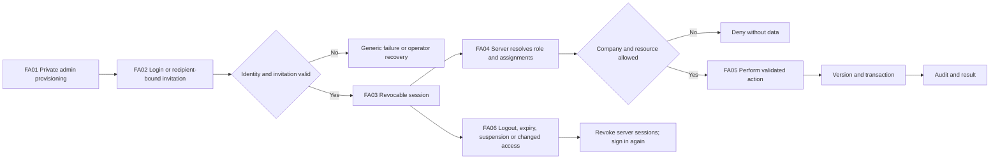
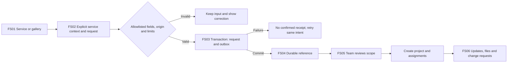
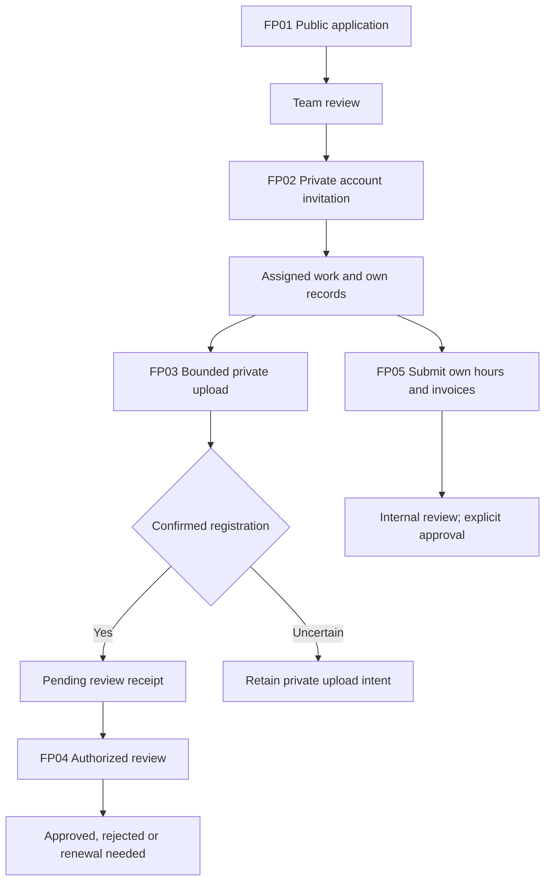
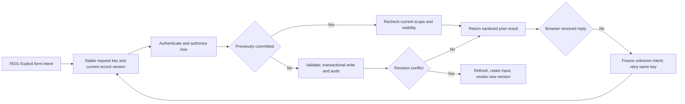

# Product flow contracts · repair revision1

Purpose: preserve TAYCO's identity while connecting information to a user's actual task and authority. Actor types: public prospect, internal staff, administrator, assigned client and assigned provider. Scope is company, project and resource. The progress authority is Soul Ledger project tayco-product-atlas7; this document describes contracts, not live completion status.

## FA · Account lifecycle

Access is invitation-only. An invitation never grants administrator authority or another company. Assignment edits are versioned and revoke existing sessions. Recovery is operator assisted until a verified recovery channel is configured.

## FS · Public intake to project

The form preserves original contact fields and calculator assumptions. The budget illustration is not an agreed quote. Public requests are not linked to a demonstration project. Saving and email delivery are separate; worker configuration and retry age are explicit.

## FP · Provider documents and work

Tax/insurance documents are not client-facing project documents. Provider views do not contain client scope-change conversations or unrelated private team notes. Uploading does not certify the contents.

## FE · Modification and recovery

## Traceability and evidence seams

| Flow | GUI / HTTP | Persistent contract | Required evidence |
| --- | --- | --- | --- |
| FA01–FA06 | login, account, auth APIs, private CLI | users, hashed tokens, revocable sessions, assignments | invalid/expired/revoked/single-use, logout, access edit, stale version |
| FS01–FS04 | service query context, three public forms | allowlisted request + durable notification | retry after503/response loss, exact payload, one reference, no fabricated project |
| FS05–FS06 | project workspace / ERP API | project-scoped records and versioned changes | two clients, cross-company denial, provider isolation |
| FP01–FP04 | provider application, upload and download | private object path + owner/project visibility + receipt/review | oversized stream, unauthorized project before put, pending review, authorized download |
| FP05 | hours/invoices / ERP action | finite values, real dates, submitted versus approved | self-approval denied; stale updates conflict |
| FE01–FE01 | all mutation forms | actor-scoped request hashes, transaction, CAS and audit | demotion/revocation cannot recover cached data; current visibility rechecked |
| Delivery | Activity / notifications API | leased outbox with fenced finalization | missing configuration, rejection, stale lease and invalid retry age |
| Recovery | operator backup/reconciliation | snapshots, hashes, private intents | restore synthetic WAL state; dry-run does not delete objects |

Local fixture and mocked-provider results are not evidence of a real Blob/Resend/accounting/Takeoff connection, physical mobile hardware or production compliance. Those seams remain separate.
