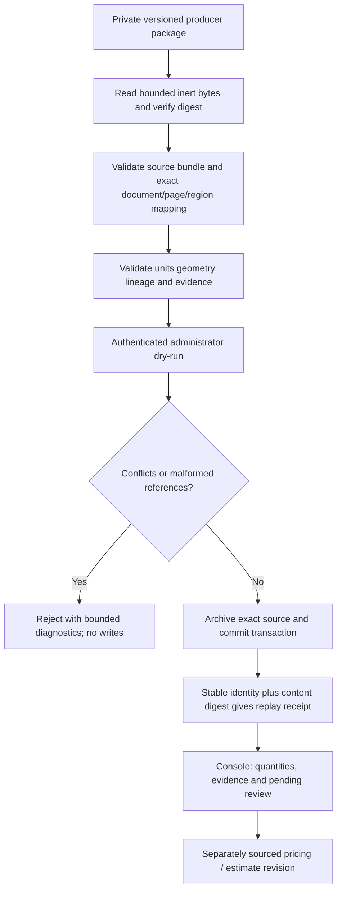

# Takeoff measurements → TAYCO: consumer contract

Status: proposed handoff for the producer's M02 schema, not an implemented endpoint. Raw calibration/measurement/BOQ reception still needs an adapter, tests and UI projection.

## Existing receiving path

- `lib/takeoff-estimate-source.ts:takeoffEstimateSnapshots` parses inert source bytes for an active scenario, structured executive BOQ export and optional APU.
- `scripts/import-takeoff-estimate.ts` inspects by default; apply requires an active administrator and a private source archive.
- The existing source schemas are `takeoff_active_scenario.v1` and `takeoff_apu_procurement.v1`, plus the report's structured financial payload and CSI table.
- ERP actions `restore_estimate_project` and `import_project_estimate` preserve versioned aggregate estimates. They are not a raw geometry, calibration or measured-quantity API.
- Estimate and source-document registration remain different operations. The imported Takeoff bundle is already pinned; a new measurement package must reference it rather than mutate it.
- The legacy estimate recovery matches `sourceProjectSlug`; document registration instead records `sourceContextKey` and exact bundle pins. Running legacy recovery blindly against a document-registered project can create a separate container. The adapter must resolve the existing TAYCO project through the exact source mapping and reject ambiguous bindings; it must not call project recovery merely because a measurement arrived.

Atlas12 owns producer extraction/calibration artifacts and its M02 schema. Atlas7 owns the TAYCO adapter, authorization, idempotent persistence and console projection. Agree the schema before creating another competing format.

## Minimum information required in the producer package

Field names may be mapped by the adapter; semantics must be explicit.

| Area | Required information |
| --- | --- |
| Envelope | Versioned schema, package ID/revision, UTC generation time, producer, exact source bundle/manifest digest, artifact manifest with SHA-256 and bytes |
| Identity | Source context key, viewer document ID, original PDF SHA-256; TAYCO project ID comes from the existing exact mapping, never a guessed name |
| Page | Explicit one-based PDF page number, sheet label when available, page dimensions, crop box and rotation; document revision must remain distinct from package revision |
| View region | Stable viewport/region ID and bounds; one sheet can contain multiple scales or details |
| Coordinate system | Explicit PDF points or normalized coordinates, origin, axis direction, page transform; DPI alone is not calibration |
| Calibration | Stable ID/revision, status, axis/method, anchors and dimension evidence, declared real length/unit, computed transform/scale, authority and review evidence |
| Measurement | Stable ID/revision, method (length/area/count/volume), source geometry, calibration reference where required, quantity/unit or explicit null, assumptions and review status |
| Deduplication | Physical scope/element identity, revision lineage, superseded/alias references, whether a measurement is additive or reference-only |
| BOQ line | Stable line ID/revision, project/scope/CSI description, unit, linked measurement revisions and aggregation rule, explicit inclusion status |
| Pricing | Separate price-source ID/SHA/revision, unit/currency/effective date/geography/scope; materials/labor/equipment and assumptions kept separate |
| Review | Pending reasons, evidence references and reviewer decisions; measurement approval is distinct from commercial approval |

No local absolute paths, secrets, document binaries or private customer details are embedded in repository fixtures. Evidence files travel privately and use relative, confined references.

## States and arithmetic

- A printed scale is a candidate until its dimension/evidence and applicable region are checked. A calibration copied from another page or region does not become confirmed automatically.
- Preserve pending, conflicting, rejected and superseded evidence for review. Pending quantity or price is null, never zero.
- Counts may not require a length calibration, but still need a traceable object/geometry selection and deduplication scope.
- Length requires a matching regional calibration; area and volume require dimensionally valid transforms and explicit additional dimensions.
- Preserve source and normalized units with a declared conversion. Do not add unlike dimensions or currencies.
- Deductions/openings and waste factors are explicit signed operations or named factors; do not silently take an absolute value.
- Do not add alternate revisions, drawing aliases, elevations and details as separate physical quantities.
- A measured quantity, its priced estimate and an approved contract are different records. Missing pricing does not prevent receiving measured quantities.
- The supplied bundle's two reference collections are not automatically measurable projects.

## Receiving sequence

Same identity/revision and same digest returns the existing receipt. A changed payload under that identity conflicts; an explicit new revision must declare supersession. Replay after lost acknowledgment cannot create duplicate BOQ lines. Importing a later package cannot erase review decisions, replace source PDFs or silently expand guest grants.

## Required probes before claiming reception complete

1. Exact mapping and synthetic calibrated quantity persist; replay creates nothing new.
2. Changed same-revision bytes conflict and a failed transaction leaves no partial records.
3. Wrong PDF hash, unknown page/region, out-of-bounds geometry and wrong units reject.
4. Nominal-only calibration cannot yield a confirmed length or area.
5. Aliases/superseded revisions do not double count; reference-only source stays excluded from additive quantities.
6. Quantity-only lines remain usable with missing prices; unverified or incompatible prices never become a final total.
7. Administrator import and authorized console reading work; anonymous, other tenant/project and ungranted guest cannot retrieve source details.
8. Console visibly separates pending measurements, verified quantities, price evidence and independent estimate revisions.

## Immediate producer handoff

Deliver the candidate M02 schema and two synthetic examples (one confirmed, one pending/conflicting), then a private artifact inventory keyed by context/document/page/SHA. TAYCO will adapt that agreed format instead of requiring raw measurement geometry to masquerade as an aggregate estimate snapshot.

This contract does not authorize a Railway deployment, publish real quantities or supply a general TAYCO rate card.
