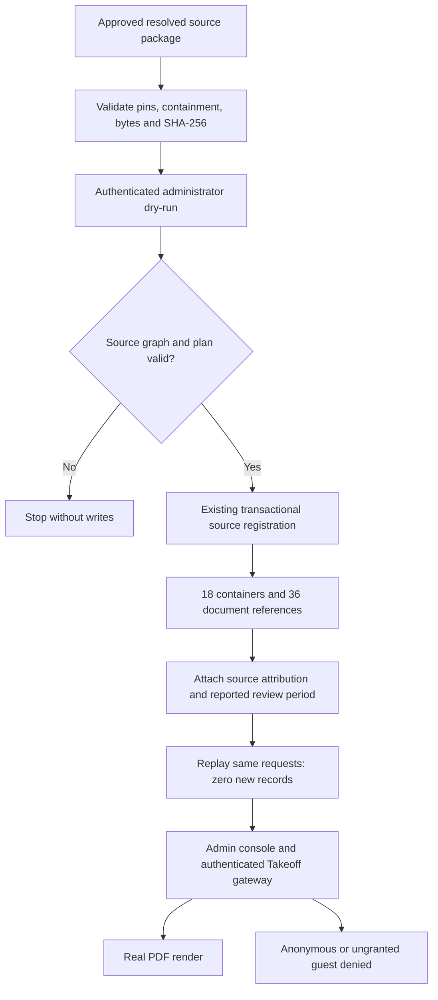

# Takeoff source intake — local review evidence

Verified on 2026-10-23 against branch `codex/tayco-guest-current-console`, source HEAD `8602cbb`. This records a local data intake, not a Railway deployment or a completed commercial dossier.

## Scope and provenance

The approved resolved-source package contains 18 contexts and 36 documents. Sixteen contexts contain drawings; two are reference collections. Three unresolved contexts remain excluded. All 72 resource files were independently checked for containment, symlinks, byte length and streaming SHA-256 before registration.

The package supplies source documents and page-index excerpts. It does not establish accepted proposals, completed commercial stages, calibrated quantities, approved budgets, invoices or lost revenue. October 2026 is the human-reported review period; it does not replace document dates or imply that an import occurred in October business operations.

Private package files, source names, mappings, databases, credentials and screenshots remain outside Git in the ignored `.data/` review area.

## Executed flow



No guest invitation or external publication was created by this intake. Source visibility remains owner-only. Access grants and business-data reconciliation are separate steps.

## Observed results

| Check | Result |
| --- | --- |
| Source verification | 18 contexts, 36 documents, 72 resources; 579,290,686 bytes independently rehashed |
| Dry-run | ERP record count stayed at zero |
| First apply | 54 records: 18 source containers and 36 documents |
| Repeat apply | Zero new records; same 54 records retained |
| Commercial records | No invoices, estimates, proposals, purchase orders or work logs manufactured |
| Admin API | ERP snapshot, scoped catalog and selected document metadata returned 200 |
| Binary delivery | Selected real PDF returned 206 for Range, with PDF signature; HEAD returned 200 |
| Anonymous delivery | Same PDF gateway request returned 401 |
| Cache policy | Private, no-store |
| Guest scope | Ungranted guest denied; no new guest approvals added |
| Desktop browser | Native click opened Projects; source files and Reference Only labels appeared. Protected reader rendered a real PDF canvas |
| Mobile emulation | 390 × 844 viewport: outer page and embedded document had no document-level horizontal overflow; native CDP touch moved the page from scrollY 0 to 305 |
| Focused regression | 58 tests passed, 0 failed across registration, registration route, viewer access and gateway |

The selected PDF was visually inspected on desktop and in the mobile reader. This is a sample render, not a claim that every page of every document was manually reviewed. Mobile testing used Chromium emulation, not a physical handset.

## Remaining work

- Reconcile explicit project identities, estimates, proposal revisions and commercial evidence from the corresponding business sources. Do not join collections by counts or approximate names.
- Refine portfolio summary counts: the current administrative overview counts all 18 containers as projects, although two are reference-only; it must not be presented as 18 confirmed operating jobs.
- The source-review status is visible in project detail but falls into Unknown in the existing summary grouping. Preserve this distinction when refining the dashboard.
- Review the separate insurer-facing disclosure scope before any recipient-specific grant. Generic review access does not authorize distribution of every source document.
- Implement and verify the four-hour absolute review grant, expanded audit and privacy/cookie controls described in `guest-review-console-design.md`.
- Coordinate a single reviewed Railway release and private source transfer. This local result does not change cloud data.

## Repeatable review

Use the existing `takeoff-source-registration` planner/commit contract with persisted administrator authentication, exact bundle/relations/manifest pins, an approved plan hash and stable idempotency keys. Use a dedicated review database and preserve receipts. Never substitute direct ad-hoc project insertion for registration.

The private review folder retains integrity, dry-run, import, mapping and HTTP evidence, plus the contained loopback launch configuration. The preview servers have bounded lifetimes and bind only to 127.0.0.1. Do not publish their internal viewer origin or copy private source files into the repository.

Focused regression command:

```sh
node --import tsx --test tests/takeoff-source-registration.test.ts tests/takeoff-registration-route.test.ts tests/takeoff-viewer-access.test.ts tests/takeoff-viewer-gateway.test.ts
```

## Immutable local source extensions

Later received PDFs can be added through a new immutable bundle while preserving the previous manifest, resource bytes, document identities and ERP records. Keep the previous exact mappings, validate inheritance against the prior manifest, and register only the added sources through the existing administrator planner/commit contract. A received-document collection is a reference container, not evidence of another operating project.

Preserve conflicting source labels as review caveats. A PDF containing photographs remains a reference document; a matching checksum proves file identity but does not independently establish its association with a reported business opportunity. Structural page inventory does not claim OCR, calibrated measurements or complete drawing coverage.

The local extension was exercised with dry-run, transactional registration and receipt replay; previous records remained unchanged. Authenticated metadata, GET Range and HEAD succeeded for the added PDFs, anonymous binary requests returned 401, and cache policy remained private/no-store. The administrative profile resolved its received-file links and a newly registered PDF rendered through native desktop and mobile navigation. The focused registration, route, access, gateway and profile suite passed 64 tests.

This evidence covers local administrative source delivery. It does not certify an insurer-specific allowlist, a four-hour grant, expanded audit/privacy controls, a cloud release, or manual review of every PDF page. Private lineage, runtime receipts and screenshots stay in the ignored local review area.
