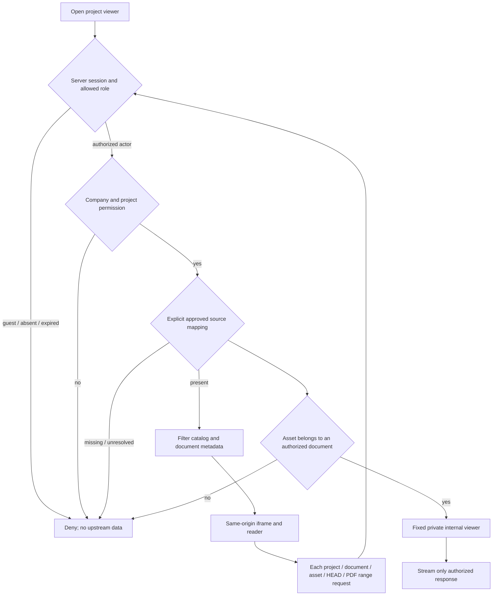

# Protected Takeoff viewer integration

Status: agreed design only, October 23, 2026. No gateway route, document publication,
project-source association or access grant is implemented by this document.

Purpose: let authorized TAYCO users read approved project plans and processed information
inside the existing workspace without including Takeoff processing/OCR engines in the web viewer.

## Ownership and transport

- TAYCO owns navigation, session, role/company/project/document authorization, explicit source
  mappings and the same-origin gateway. TAKEOFFPRO owns the viewer, exporter, bundle,
  manifest integrity, base-path generation and document delivery.
- Review origin: `https://tayco-review-product-review.up.railway.app`.
- Agreed `TAKEOFF_VIEWER_BASE_PATH=/api/takeoff-viewer`. TAYCO preserves the **entire**
  prefix when forwarding to a fixed operator-configured internal Railway service. No prefix
  stripping or HTML/JS/JSON rewriting. Local preview defaults to an empty base path.
- Future GUI route: `/portal/takeoff/[projectId]`; future iframe entry:
  `/api/takeoff-viewer/viewer/?embed=1&project=<context-key>&document=<id>&page=N`.
  Selection IDs and page number are navigation only and never authorize a request.
- All generated API/asset links, static resources, PDF.js imports/worker/CMaps/fonts/wasm
  and redirects stay under the configured base. A proxy prefix alone cannot fix root-absolute URLs.
- No browser-provided upstream URL, forwarded TAYCO session cookie, shared private-response
  cache, public bundle endpoint or new bootstrap endpoint is required.

## Internal relationship artifact

The proposed `takeoff-viewer-relations/v1` artifact identifies `bundleId` and
`manifestSha256`, and contains:

| Entity | Relationships |
| --- | --- |
| Context | `contextKey`, `displayName`, `identityStatus`, `documentIds` |
| Document | `documentId`, `contextKeys`, `assetIds`, `kind` |
| Asset | `assetId`, `documentIds` |

In v1 **each document has exactly one owner context**. `contextKeys` may use an array,
but its cardinality is one and must agree with the context membership and original store.
Source aliases do not create new owners. Shared assets may refer to multiple documents.
A future true multi-context document model requires an explicit compatible schema change and tests.
No original local file paths, secrets or invented tenant/project associations are added.

TAYCO separately records approved tenant/project-to-context/document mappings. Several
TAYCO projects may use one context only when each association is explicitly approved;
this never grants every project or actor in a tenant access. Missing or unresolved mappings
deny access. Similar names, source aliases and matching hashes do not establish authority.

## Authorization flow

- Admin/staff remain company-scoped and mapped to approved sources.
- Clients require the assigned project and a document shared with the client.
- Vendors retain their existing document ownership/visibility restriction.
- Guests have summary-only access and are always denied viewer documents.
- Check catalog filtering, metadata/text access and document-to-asset relationships server-side.
  Never return the complete private catalog and hide entries in client JavaScript.
- Authorize every GET, HEAD and PDF byte-range request. Preserve streaming, MIME,
  `Range`, `Accept-Ranges`, `Content-Range` and appropriate206/416 responses.
  A once-authorized iframe does not authorize future requests or revoked sessions.

## Browser policy compatibility

The current TAYCO policy includes COEP `require-corp`. Child navigation and dedicated-worker
embedder policies must be compatible; setting CORP alone does not replace those checks.
The gateway must deliver exactly one valid COEP value, rather than concatenate upstream
and global headers. Even `require-corp, require-corp` is parsed as invalid and defaults to
`unsafe-none`. See the primary [HTML embedder-policy checks](https://html.spec.whatwg.org/multipage/browsers.html#check-a-navigation-response%27s-adherence-to-its-embedder-policy)
and [header parsing](https://html.spec.whatwg.org/multipage/browsers.html#the-coep-headers).

For a same-origin proxy, `frame-ancestors 'self'` remains consistent. Verify framing,
reader/worker loading and all dependent resources without loosening TAYCO global CSP,
COEP/CORP or enabling unrestricted CORS. These headers do not substitute for authorization.

## Verification and release gates

| Gate | Required evidence before claiming completion |
| --- | --- |
| Viewer compatibility | Empty and configured base; normalized trailing slash; reject external/query/fragment/traversal bases; no accidental root `/api/v1` or `/static` fetches. |
| Relationships | Manifest hash/version verified; v1 single-owner consistency; shared assets and unresolved identities exercised; no fabricated multi-context support. |
| Access | Admin/staff company scope; assigned and unassigned clients; vendor-owned and other documents; guest/anonymous/expired/revoked sessions; forged IDs and cross-company mappings. |
| Transport | GET/HEAD, valid/invalid ranges206/416, last PDF page and worker/resources load through the prefix; no complete PDF buffering by gateway. |
| Policies | Actual parent `require-corp` iframe+reader+worker test, negative incompatible child/worker and duplicate-COEP cases; one effective valid response value. |
| Product | Project navigation and page/deeplink on mobile/desktop, private upstream unreachable directly, no typed-secret or full-path leakage. |
| Recovery | Upstream unavailable/malformed manifest/unauthorized association fail clearly without exposing a fallback full catalog. |
| Publication | Operator-approved source selection and explicit mappings, isolated deployment and authenticated runtime evidence. Local export is not publication permission. |

VMOF decision: prefer a private service with same-origin authenticated gateway over a public
cross-origin iframe requiring a separate browser authentication exchange. The former reuses
existing TAYCO access and avoids relying on third-party iframe session cookies. Aerospace
containment: deny before upstream data; per-resource checks; bounded streaming and explicit
policy tests. Recovery must not substitute public URLs or bypass authorization.

Coordination evidence: Randolf's native message `01a16995-2677-73f2-846b-204bf19ef883` in
Atlas-evrfpc12 chat `01a11bd1-ce75-7182-85b1-bcf086f20eeb`; contract confirmed by both
chairs on October23. Next deliverable from atlas12: source commit, relation artifact and
local prefix/policy test evidence. Actual TAYCO project/document mappings are still pending.
