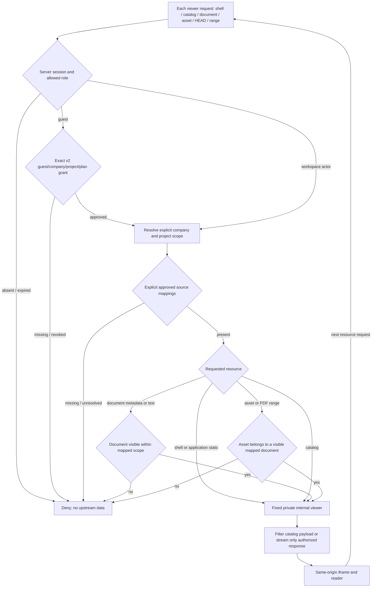

# Protected Takeoff viewer integration

Status: local protected gateway and explicit guest review implemented and exercised, October 23, 2026. Actual customer source registration and private Railway reader publication remain pending. Configuration and test fixtures do not publish customer documents.

Purpose: let authorized TAYCO users read approved project plans and processed information
inside the existing workspace without including Takeoff processing/OCR engines in the web viewer.

## Ownership and transport

- TAYCO owns navigation, session, role/company/project/document authorization, explicit source
  mappings and the same-origin gateway. TAKEOFFPRO owns the viewer, exporter, bundle,
  manifest integrity, base-path generation and document delivery.
- Review origin: `https://tayco-review-product-review.up.railway.app`.
- Agreed `TAKEOFF_VIEWER_BASE_PATH=/api/takeoff-viewer`. TAYCO preserves the **entire**
  prefix when forwarding to a fixed operator-configured internal Railway service. No prefix
  stripping or HTML/JS/JSON rewriting. Local preview defaults to an empty base path.
- GUI route: `/portal/takeoff/[projectId]`; iframe entry:
  `/api/takeoff-viewer/viewer/?embed=1&project=<context-key>&document=<id>&page=N`.
  Selection IDs and page number are navigation only and never authorize a request.
- All generated API/asset links, static resources, PDF.js imports/worker/CMaps/fonts/wasm
  and redirects stay under the configured base. A proxy prefix alone cannot fix root-absolute URLs.
- No browser-provided upstream URL, forwarded TAYCO session cookie, shared private-response
  cache, public bundle endpoint or new bootstrap endpoint is required.

## Internal relationship artifact

The proposed `takeoff-viewer-relations/v1` artifact identifies `bundleId` and
`manifestSha256`, and contains:

| Entity | Relationships |
| --- | --- |
| Context | `contextKey`, `displayName`, `identityStatus`, `documentIds` |
| Document | `documentId`, `contextKeys`, `assetIds`, `kind` |
| Asset | `assetId`, `documentIds` |

In v1 **each document has exactly one owner context**. `contextKeys` may use an array,
but its cardinality is one and must agree with the context membership and original store.
Source aliases do not create new owners. Shared assets may refer to multiple documents.
A future true multi-context document model requires an explicit compatible schema change and tests.
No original local file paths, secrets or invented tenant/project associations are added.

TAYCO separately records approved tenant/project-to-context/document mappings. Several
TAYCO projects may use one context only when each association is explicitly approved;
this never grants every project or actor in a tenant access. Missing or unresolved mappings
deny access. Similar names, source aliases and matching hashes do not establish authority.

## Authorization flow

- Admin/staff remain company-scoped and mapped to approved sources.
- Clients require the assigned project and a document shared with the client.
- Vendors retain their existing document ownership/visibility restriction.
- Guests retain summary-only financial access. A separate v2 approval can grant selected project summaries and complete approved project-plan documents; it never expands generic ERP, accounting, contacts, tax or insurance-document access. V1 and unapproved guests remain denied.
- Check catalog filtering, metadata/text access and document-to-asset relationships server-side.
  Never return the complete private catalog and hide entries in client JavaScript.
- Authorize every GET, HEAD and PDF byte-range request. Preserve streaming, MIME,
  `Range`, `Accept-Ranges`, `Content-Range` and appropriate206/416 responses.
  A once-authorized iframe does not authorize future requests or revoked sessions.

## Browser policy compatibility

The current TAYCO policy includes COEP `require-corp`. Child navigation and dedicated-worker
embedder policies must be compatible; setting CORP alone does not replace those checks.
The gateway must deliver exactly one valid COEP value, rather than concatenate upstream
and global headers. Even `require-corp, require-corp` is parsed as invalid and defaults to
`unsafe-none`. See the primary [HTML embedder-policy checks](https://html.spec.whatwg.org/multipage/browsers.html#check-a-navigation-response%27s-adherence-to-its-embedder-policy)
and [header parsing](https://html.spec.whatwg.org/multipage/browsers.html#the-coep-headers).

For a same-origin proxy, `frame-ancestors 'self'` remains consistent. Verify framing,
reader/worker loading and all dependent resources without loosening TAYCO global CSP,
COEP/CORP or enabling unrestricted CORS. These headers do not substitute for authorization.

## Verification and release gates

| Gate | Required evidence before claiming completion |
| --- | --- |
| Viewer compatibility | Empty and configured base; normalized trailing slash; reject external/query/fragment/traversal bases; no accidental root `/api/v1` or `/static` fetches. |
| Relationships | Manifest hash/version verified; v1 single-owner consistency; shared assets and unresolved identities exercised; no fabricated multi-context support. |
| Access | Admin/staff company scope; assigned and unassigned clients; vendor-owned and other documents; guest/anonymous/expired/revoked sessions; forged IDs and cross-company mappings. |
| Transport | GET/HEAD, valid/invalid ranges206/416, last PDF page and worker/resources load through the prefix; no complete PDF buffering by gateway. |
| Policies | Actual parent `require-corp` iframe+reader+worker test, negative incompatible child/worker and duplicate-COEP cases; one effective valid response value. |
| Product | Project navigation and page/deeplink on mobile/desktop, private upstream unreachable directly, no typed-secret or full-path leakage. |
| Recovery | Upstream unavailable/malformed manifest/unauthorized association fail clearly without exposing a fallback full catalog. |
| Publication | Operator-approved source selection and explicit mappings, isolated deployment and authenticated runtime evidence. Local export is not publication permission. |

VMOF decision: prefer a private service with same-origin authenticated gateway over a public
cross-origin iframe requiring a separate browser authentication exchange. The former reuses
existing TAYCO access and avoids relying on third-party iframe session cookies. Aerospace
containment: deny before upstream data; per-resource checks; bounded streaming and explicit
policy tests. Recovery must not substitute public URLs or bypass authorization.

Coordination evidence: Randolf's native message `01a16995-2677-73f2-846b-204bf19ef883` in
Atlas-evrfpc12 chat `01a11bd1-ce75-7182-85b1-bcf086f20eeb`; contract confirmed by both
chairs on October23. Atlas12 delivered locale commit a8951ce and pinned-response commit dcc000551. Actual TAYCO project/document mappings remain operator-controlled and separate from source identity.

## T52 local implementation contract (not deployed)

The local TAYCO implementation adds `lib/takeoff-viewer-access.ts`,
`lib/takeoff-viewer-gateway.ts`, protected GET/HEAD catch-all handlers and
`/portal/takeoff/[projectId]`. The Takeoff Pro bridge links existing assigned project readers.
Configuration presence is labeled **Viewer configured**, not a health or publication claim.
No production configuration or real project/source associations are created by these files.

### Private operator inputs

- `TAYCO_TAKEOFF_VIEWER_INTERNAL_URL`: one fixed upstream origin, no credentials,
  path, query or fragment. Plain HTTP is restricted to loopback/Railway internal hosts.
- `TAYCO_TAKEOFF_RELATIONS_PATH`: private readonly `takeoff-viewer-relations/v1` artifact.
- `TAYCO_TAKEOFF_MAPPING_PATH`: private operator JSON with schema
  `tayco-takeoff-viewer-access/v1`, `bundleId`, `relationsSha256` (SHA256 of the exact
  relationship-file bytes) and `mappings`.
- Each mapping is `{tenantId, projectId, contextKey, documents:[{viewerDocumentId,
  erpDocumentId}]}`. Every ERP document must already exist in that project/company and
  remain readable under current document visibility/ownership. Missing/deleted/purged
  records never grant a fallback. Mappings are not supplied by browser query parameters.
- File sizes, types, IDs, unique entries, schema versions and inverse relationships are checked.
  A mismatched pin or invalid/unresolved mapping fails closed. Startup never seeds grants.

The gateway requires `X-Takeoff-Bundle-Id` and `X-Takeoff-Manifest-Sha256` to match the
pinned snapshot on each upstream response, including HEAD/ranges and416. The identity
headers are control metadata, not authorization. Catalog JSON also checks `bundle_id`.
Document asset URLs must belong to that particular document, not merely another visible one.
In v1 an approved document grants complete registered asset bytes; there are no page-level
access grants. An identical shared asset can be delivered via one readable document without
exposing sibling document/context metadata.

Catalog/document JSON uses a bounded whitelist. Raw arbitrary metadata, references and
revisions are removed rather than relayed across scopes. Known candidate scale/index text,
explicit `calibration_applied:false`, text availability, sheet marks, measurements, BOQ and
paragraphs remain available without being promoted to verified data. Unknown page counts
remain null, including DOCX. Large/invalid JSON and unexpected redirects return generic errors.
PDF bodies stream with request cancellation/idle timeout instead of buffering the whole file.
No cookies, authorization headers or forwarded upstream selector reach the private viewer.

### Browser and source compatibility gates

The viewer must expose the prefix-aware `i18n.js` module and use server locale `en` for
TAYCO, with no translation of original document contents. Source viewer V07/V08 language
and identity-header commits are separate dependencies requiring runtime verification.

Only the gateway path overrides parent framing denial with SAMEORIGIN and
`frame-ancestors 'self'`; global site policies remain unchanged. A single COEP `require-corp`
is selected. Script policy remains strict `'self'`; optional WebAssembly permission was not
applied. Basic PDF rendering does not certify all WASM-dependent image/font decoding paths.
No relaxation is introduced through another file/tool to work around that omitted change.

## T53 explicit guest project review

Human scope: Randolf requested the private guest link to show the October projects and their
plans, while earlier months retain summary-only financial access. October is a reported
business review period; a drawing revision date does not establish when a contract,
meeting, estimate or financial transaction occurred.

Mapping v2 retains all v1 fields and adds:
~~~json
{
  "schemaVersion": "tayco-takeoff-viewer-access/v2",
  "bundleId": "<pinned bundle>",
  "relationsSha256": "<exact relation artifact SHA256>",
  "mappings": [],
  "guestReviews": [{
    "tenantId": "<company>", "guestId": "<specific guest>",
    "projectId": "<registered project>", "period": "YYYY-MM",
    "viewerDocumentIds": ["<approved document>"]
  }]
}
~~~

Every selected document must belong to that exact mapped project and remain an existing,
non-deleted/non-purged ERP document with category project. Guest account projectIds
remain empty; no staff actor is forged. The server reads only approved project summary
fields and plan eligibility flags for the guest. The SSR payload contains project ID/name,
review period, recorded status/progress, explicitly reported commercial steps and approved
document count. Unknown progress stays null. No budgets, contacts, private source paths,
actor IDs or audit history are projected. Each subsequent viewer resource rechecks access.

The project.open activity accepts only an approved project ID plus the semantic event/UUID.
The server checks the current guest grant before writing. Other activity types reject
project IDs; typed contents, names, arbitrary URLs and document contents are not tracked.
Existing visit, rate-limit, retention and deduplication constraints remain intact.

### Local observed evidence

- Access policy:24 isolated tests, preserving14 v1 cases and adding exact v2 grants,
  company/guest membership, category/deletion/revocation and safe summary projection.
- Combined gateway/policy route fixtures:21 tests including persisted real NextRequest
  sessions, v1 denial, unauthorized siblings, HEAD/range and next-request revocation.
- Activity:11 tests including v2 approval, strict metadata, migration and deduplication.
- Production Next build and scoped ESLint passed after guest cards/SSR integration.
- Real Next server plus actual Takeoff FastAPI viewer, synthetic PDFs only: authenticated
  guest catalog/document200, HEAD200, byte range206 (32 bytes), unsatisfiable416;
  anonymous401; sibling/other-company documents404; generic ERP/finance/details403.
- Daedalus: actual PDF canvas visible on desktop;390×844 mobile has no outer/layout
  horizontal overflow; native CDP touch changed PDF page1 to2 and retained the canvas.
  This is Chromium emulation, not a physical handset or WebKit certification.

Private test evidence is ignored in .data/review-viewer-20261023T172428Z/.
These observations certify the tested local flow, not a Railway source publication,
every possible PDF decoder, document completeness or unverified OCR/calibration.

## Source-backed registration and private operator inputs

The local registration utility previews exact manifest/relationship SHA pins, resolved context and selected documents. A commit binds the approved plan hash, operator identity, company and idempotency key; records, audit and receipt are transactional. New financial values, execution dates and progress remain unknown. External documents use storage=takeoff_viewer and complete source identities without a fabricated blobPath. Generic guest document endpoints remain denied. Authorized workspace downloads validate the current source and permission scope before redirecting to the fixed protected reader.

Source-managed documents are excluded from physical Blob purge, including mixed legacy records. Soft removal and approval revocation still remove viewer access. The immutable source package is managed by its producer, independently of TAYCO retention.

Optional private-operator-inputs is created empty for normal Docker builds. Only an explicitly approved deployment package supplies metadata files; they are never committed or copied under public/. Asset bytes remain in the separate private reader service. The temporary source-registration API requires its explicit feature flag, a fresh administrator session and same-origin POST. Disable the flag after the reviewed import.
