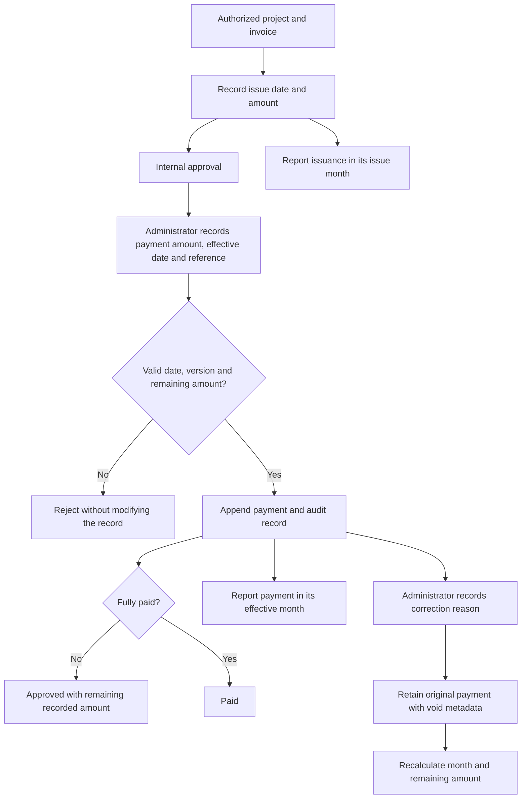

# Workspace modules and monthly reporting

The default private workspace is the Executive overview. Desktop has a grouped module sidebar; smaller screens use the Open modules disclosure. Changing modules moves focus to the selected content. Company-wide requests, providers and activity clear the project selector; project operations retain its selected scope.

## Recorded operations

- Executive overview: dated monthly commercial/work activity, current project status and proposal pipeline, explicit team coverage, incoming requests, recent activity and links to source modules. Monthly activity and current-state inventory are labeled separately.
- Client proposals (internal): source-backed USD proposals, dated sending and acceptance/decline/withdrawal decisions. These are distinct from supplier offers and commercial requests; no email or accounting entry is created by recording a decision.
- Project teams (internal): active company accounts, explicit responsibilities and dated assignment history. Roster membership does not change account access.
- Estimates & scenarios (internal): privately archived source revisions with independent totals, exact cost divisions and material/labor/equipment tiers; estimates never imply contract award or cash movement.
- Projects: schedules, milestones, approved budget provenance, contacts and shared information.
- Bid leveling: separately recorded supplier offers with project, scope, amount, date and source; internal review and shortlist/accept/decline decisions. Providers see their own assigned offers.
- Purchase orders: internal creation, optionally linked to an accepted matching offer; draft → issued → acknowledged → received → closed, with cancellation before receipt. A recorded acknowledgement is an internal record, not proof of supplier delivery.
- Team hours: dated work records and internal review. This is preparation data, not a certified payroll filing.
- Tax & TERO: project requirements, due dates and manual review evidence. Completion requires a review date and evidence; no tax calculation, eligibility determination or filing is implied.
- Financial overview and invoices: dated issuance, separately recorded partial payments and retained correction history.
- Investor & lender dossier: an authorized **client-facing** JSON package. It includes approved shared project documents and client invoices; it excludes internal procurement, provider invoice data and private storage paths. The same conservative export applies to team accounts.
- Takeoff Pro bridge: integration availability and project context. Until configured, it reports unavailable rather than returning demonstration figures.
- Requests, partners, updates, changes, documents, account access and activity remain available with role-specific authority.

## Monthly financial basis

An invoice belongs to its explicit issue date. Only when that date is absent may its recorded date be used, visibly labelled as a fallback. An invalid explicit date remains unknown. A payment belongs to its own effective date, even if its invoice was issued in a different month. Changing an invoice's current status never creates a historical payment date.

Year/month filters, a twelve-month chart, an exact-value table and the protected CSV use the same calculation. Client billing, supplier invoices and internal records stay separate; their totals are not combined into profit or net cash flow. Current status counts describe the selected issuance cohort, not a reconstructed historical balance sheet.

Recording or voiding payment metadata never sends, refunds or transfers money. Duplicate references, overpayments, invalid dates, future payments and stale versions are rejected. Existing malformed histories require operator review. The API's approvedOutstandingUsd subtracts valid active payments from approved invoices; approvedOutstandingNeedsReviewCount identifies records excluded from that calculation. Legacy paidRecordedUsd remains a current paid-invoice cohort amount, not monthly cash receipts.

## Completeness boundary

See [the original module inventory](module-parity.md) for all 41 subfunctions and the separate input-dependent blocks. Restored navigation and tested core records do not certify EVM, G702/G703, IIF/QuickBooks synchronization, WH-347, tax filings or live Takeoff/Monte Carlo. Those require genuine contracts, mappings, upstream inputs and dedicated verification.
